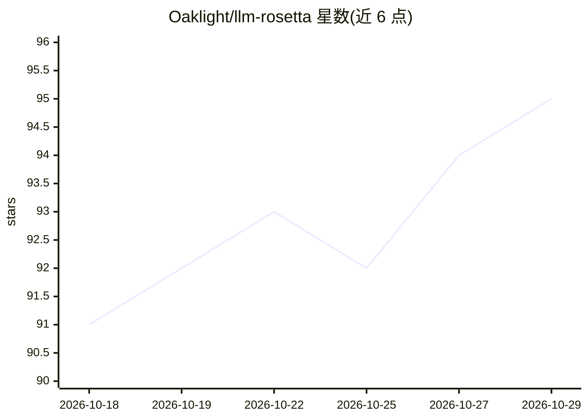

# Oaklight/llm-rosetta

⭐ 95 · Python · MIT · 推送 2026-10-26 · [GitHub](https://github.com/Oaklight/llm-rosetta) · [官网](https://llm-rosetta.readthedocs.io) · 个人维护 · 中文 README

**LLM API 格式转换库：OpenAI/Anthropic/Google 双向互转**

Python 库，通过中心中间表示（IR）实现 OpenAI（Chat Completions 与 Responses）、Anthropic Messages、Google GenAI 三家 API 格式的双向转换，解决多提供方间的 N² 转换问题；支持流式与请求/响应、文本/图像/工具调用内容，可自动检测提供方。核心零依赖（仅 typing_extensions），提供方 SDK 为可选安装。兼容任何 OpenAI 兼容端点（Ollama v0.13+、TGI、vLLM、LM Studio），另有配套合规测试工具 llm-comply。

## 筛选速览

| 维度 | 判定 | 备注 |
|---|---|---|
| AI 角色 | `ai-ecosystem` | LLM/agent 周边工具 |
| 许可风险 | `permissive` | MIT |
| 部署形态 | `library` | 以包/库形式分发 |
| 模型依赖 | local-ok | 支持本地模型 |
| 硬件要求 | — | 无带数字的原话,不猜 |
| 安装摩擦 | `low` | 无编译、无系统依赖或容器化 |
| 成熟度 | — | 结构信号不足 |

## 能力要点

- hub-and-spoke 架构：每个提供方只需一个到共享 IR 的转换器
- 支持流式与非流式、文本/图像/工具调用与工具结果
- 自动检测请求/响应对象的提供方来源
- 核心零依赖（仅 typing_extensions），提供方 SDK 可选

## 适用场景

- 多提供方 LLM 应用中转换请求与响应格式
- 构建或验证 LLM API 网关与代理时做格式互转
- 跨提供方迁移对话内容与工具调用数据

## 场景标签

 · 领域:LLM 基础设施/API 互操作

## 证据(README 行号)

> L14: **LLM-Rosetta** — A Python library for converting between different LLM provider API formats using a hub-and-spoke 
> L25: When building applications that work with multiple LLM providers, you face an N² conversion problem — every provide
> L57: - Bidirectional conversion: requests to provider format, responses from provider format

## 星数曲线

2026-10-18 91 → 2026-10-29 95（+4）

---
*卡片 v1 · prompt 1.4 · 生成 2026-10-23 · 置信度 high · 依据 README sha `0152e3bc8b6a` · [字段定义](../../DATASET.md)*
