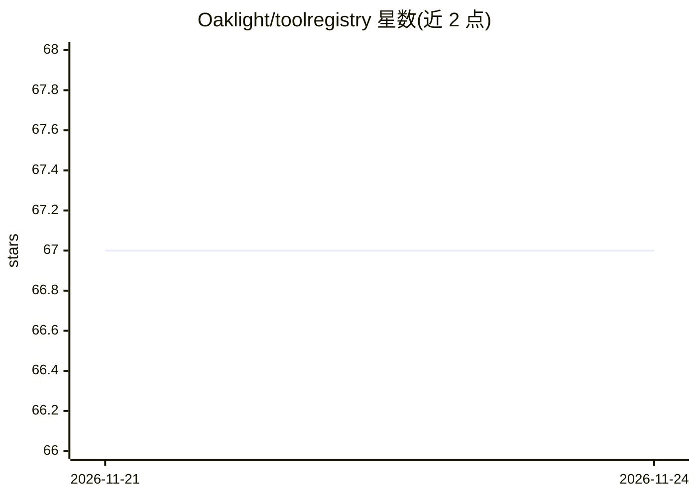

# Oaklight/toolregistry

⭐ 67 · Python · MIT · 推送 2026-11-22 · [GitHub](https://github.com/Oaklight/toolregistry) · [官网](https://toolregistry.readthedocs.io) · 个人维护 · 中文 README

**为函数调用 LLM 应用统一注册与执行工具的 Python 库**

面向构建 function-calling LLM 应用的开发者，提供协议无关的工具管理层：从原生 Python 函数/类、MCP 服务器、OpenAPI 规格或 LangChain 工具统一注册，生成 OpenAI/Anthropic/Gemini 三种格式的工具 schema，并执行调用。支持线程/进程池并发、按工具的超时与并发控制、基于标签的权限策略（allow/deny/ask）、JSONC/YAML 声明式配置与内置 Web 管理面板（中英文）。核心库运行时依赖仅 pydantic 与 llm-rosetta，要求 Python ≥3.10，以 PyPI 包形式分发，并有配套 server 与 hub 两个子包及 arXiv 论文。

## 筛选速览

| 维度 | 判定 | 备注 |
|---|---|---|
| AI 角色 | `ai-ecosystem` | LLM/agent 周边工具 |
| 许可风险 | `permissive` | MIT |
| 部署形态 | `library` | 以包/库形式分发 |
| 模型依赖 | — | README 未给出锁定关系 |
| 硬件要求 | — | 无带数字的原话,不猜 |
| 安装摩擦 | `low` | 无编译、无系统依赖或容器化 |
| 成熟度 | — | 结构信号不足 |

## 能力要点

- 统一接口注册 MCP、OpenAPI、LangChain、原生 Python 四类工具来源
- 经 llm-rosetta 生成 OpenAI/Anthropic/Gemini 三种工具 schema
- 标签化权限策略（READ_ONLY/DESTRUCTIVE/NETWORK）与并发/超时控制
- 内置 Web 管理面板（EN/ZH），核心库零额外依赖

## 适用场景

- 为多 provider 的 LLM 应用统一管理工具注册与调用
- 把已有 MCP 服务器或 OpenAPI 接口暴露给函数调用模型
- 给 agent 工具调用加权限控制与运行监控

## 场景标签

`Agent 框架` · 领域:Agent 开发

## 证据(README 行号)

> L12: A protocol-agnostic tool management library for function-calling LLMs.
> L34: - **Protocol-agnostic** — register tools from native Python functions/classes, MCP servers, OpenAPI specs, or LangC

## 星数曲线

2026-11-21 67 → 2026-11-24 67（+0）

---
*卡片 v1 · prompt 1.4 · 生成 2026-11-21 · 置信度 high · 依据 README sha `a1f37210b2bf` · [字段定义](../../DATASET.md)*
