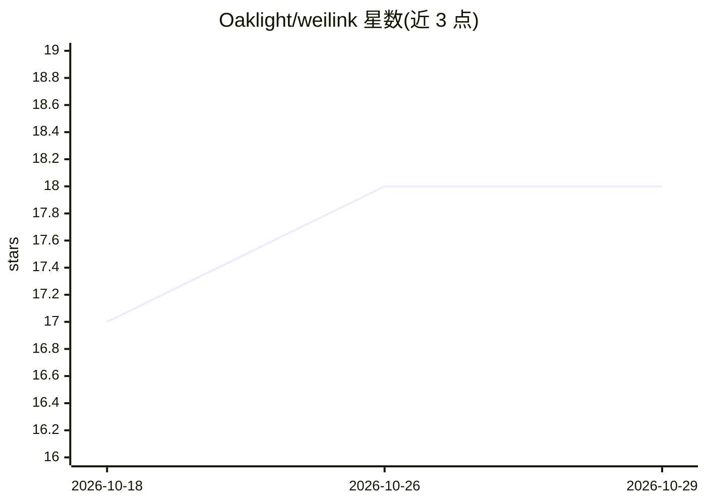

# Oaklight/weilink

⭐ 18 · Python · MIT · 推送 2026-10-21 · [GitHub](https://github.com/Oaklight/weilink) · [官网](https://weilink.readthedocs.io) · 个人维护 · 中文 README

**零依赖微信 iLink Bot 协议 Python SDK，支持多媒体与 MCP 服务器**

封装微信 iLink Bot 协议（ClawBot 插件底层协议）的 Python SDK，提供 login/send/recv 消息队列式接口，支持文本、图片、语音、文件、视频收发与媒体下载，AES 媒体加密通过 ctypes 调用 OpenSSL 并有纯 Python 兜底。凭证持久化支持重启免登录。附带统一 CLI、可选 Web 管理面板（会话管理/扫码登录）与可选 MCP 服务器（stdio/SSE/streamable-http，pip install weilink[mcp]）。限制：不能主动发起对话、24 小时回复窗口、腾讯可随时终止服务。

## 筛选速览

| 维度 | 判定 | 备注 |
|---|---|---|
| AI 角色 | `ai-ecosystem` | LLM/agent 周边工具 |
| 许可风险 | `permissive` | MIT |
| 部署形态 | `library` | 以包/库形式分发 |
| 模型依赖 | — | README 未给出锁定关系 |
| 硬件要求 | — | 无带数字的原话,不猜 |
| 安装摩擦 | `low` | 无编译、无系统依赖或容器化 |
| 成熟度 | `idea` | |

## 能力要点

- 零运行时依赖，AES 加密经 ctypes 调用 OpenSSL
- login/send/recv 消息队列接口，凭证持久化免重复登录
- 可选 MCP 服务器，支持 stdio/SSE/streamable-http 传输
- Web 管理面板支持会话管理与扫码登录

## 适用场景

- 开发微信机器人收发多媒体消息
- 通过 MCP 将 AI agent 接入微信对话
- 扫码登录后长期运行 bot 并在 Web 面板管理会话

## 场景标签

 · 领域:即时通讯/机器人 SDK

## 证据(README 行号)

> L22: - **MCP 服务器** — 可选的 MCP 集成，支持 stdio/SSE/streamable-http 传输（`pip install weilink[mcp]`）
> L9: 轻量级 Python SDK，用于微信 iLink Bot 协议。

## 星数曲线

2026-10-18 17 → 2026-10-29 18（+1）

---
*卡片 v1 · prompt 1.4 · 生成 2026-10-29 · 置信度 high · 依据 README sha `2b1b30a5a6fc` · [字段定义](../../DATASET.md)*
