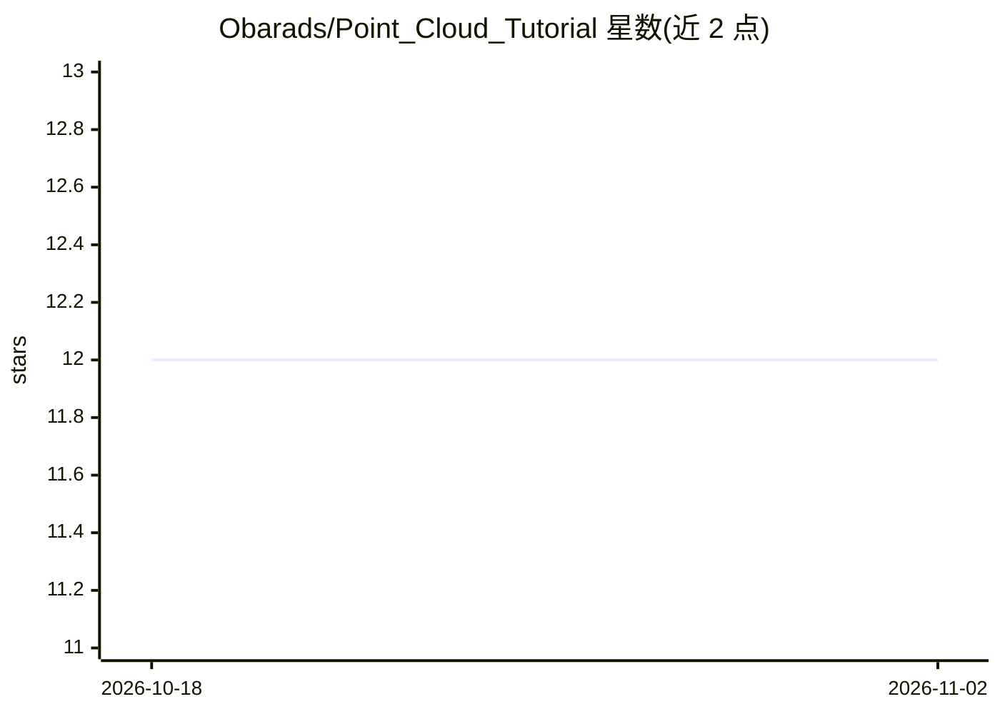

# Obarads/Point_Cloud_Tutorial

⭐ 12 · Jupyter Notebook · MIT · 推送 2026-06-21 · [GitHub](https://github.com/Obarads/Point_Cloud_Tutorial) · 个人维护

**点云处理教程仓库：Numpy/Jupyter 实现算法并配讲解**

面向学习者的点云处理教程代码与补充笔记仓库，算法多以 Numpy 和 Jupyter notebook 实现。内容分三部分：基础篇覆盖近邻搜索、降采样、法线估计、ICP 配准、SLAM 等传统算法；深度学习篇讲解 PointNet、PointNet++、VoxNet 论文对应实现；数据集篇含 ScanNet、A2D2 等示例。多数代码可在 Codespaces 的 CPU 环境运行，全部代码需 GPU 资源，环境配置参考 .devcontainer/README.md。

## 筛选速览

| 维度 | 判定 | 备注 |
|---|---|---|
| AI 角色 | `ai-knowledge` | 知识聚合/清单类 |
| 许可风险 | `permissive` | MIT |
| 部署形态 | `self-host` | docker 或自建部署 |
| 模型依赖 | — | README 未给出锁定关系 |
| 硬件要求 | — | 无带数字的原话,不猜 |
| 安装摩擦 | `low` | 无编译、无系统依赖或容器化 |
| 成熟度 | — | 结构信号不足 |

## 能力要点

- 基础算法用 Numpy/Jupyter 实现以便理解原理
- 覆盖 PointNet/PointNet++/VoxNet 等深度学习模型教程
- 收录 ScanNet、A2D2、Pix3D 等数据集的使用示例
- 提供 .devcontainer 的 Dockerfile 环境配置

## 适用场景

- 学习点云处理的传统算法与深度学习方法
- 查阅 PointNet 等论文的配套代码实现
- 在 Codespaces 或本地容器中运行教程代码

## 场景标签

`教程课程` · 领域:学习与行业

## 证据(README 行号)

> L2: This repository contains tutorial code and supplementary note for point cloud processing. In order to understand alg
> L42: |PointNet|python|PointNet: Deep Learning on Point Sets for 3D Classification and Segmentation||translation to engli

## 星数曲线

2026-10-18 12 → 2026-11-02 12（+0）

---
*卡片 v1 · prompt 1.4 · 生成 2026-11-01 · 置信度 mid · 依据 README sha `f6953997603f` · [字段定义](../../DATASET.md)*
