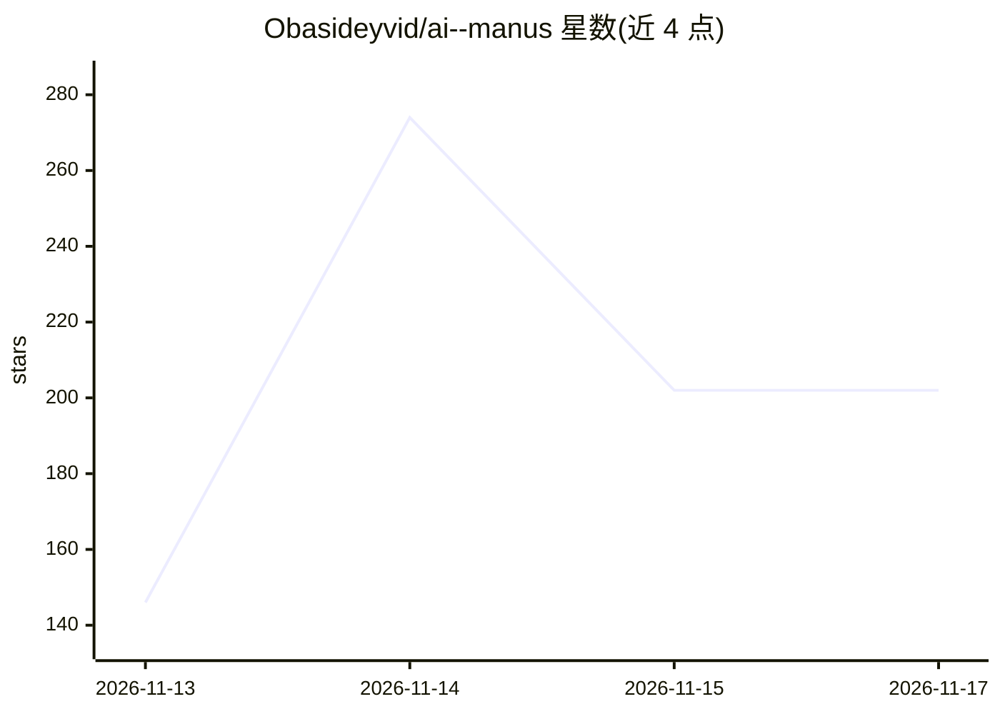

# Obasideyvid/ai--manus

⭐ 202 · Apache-2.0 · 推送 2026-11-15 · [GitHub](https://github.com/Obasideyvid/ai--manus) · 个人维护

**面向个人用户的自主 AI Agent：代为写代码、控制浏览器完成日常任务**

README 描述的 Manus 是一个自主 AI Agent：用户用自然语言下达指令后，Agent 可自行编写并执行脚本、控制浏览器完成网页导航、表单填写、多页信息收集等多步骤任务，在后台作为个人助手运行，并可在会话间复用已学到的流程。定位为家庭、学习与轻度办公场景的小型助手，明确说明非企业级平台。README 以功能介绍与使用建议为主，列出硬件兼容表（最低 4GB 内存），给出'下载'入口与上手步骤描述，但未提供具体的安装命令、代码仓库使用方式或技术实现细节。

## 筛选速览

| 维度 | 判定 | 备注 |
|---|---|---|
| AI 角色 | `ai-native` | 本体是模型或模型工具 |
| 许可风险 | `permissive` | Apache-2.0 |
| 部署形态 | `None` |  |
| 模型依赖 | — | README 未给出锁定关系 |
| 硬件要求 | — | 无带数字的原话,不猜 |
| 安装摩擦 | `low` | 无编译、无系统依赖或容器化 |
| 成熟度 | — | 结构信号不足 |

## 能力要点

- 自主代码执行：Agent 自行编写并运行脚本完成任务
- 浏览器控制：导航网页、填写表单、跨页收集信息
- 脚本与浏览器操作可在同一工作流中衔接
- 面向家庭/学习/轻办公的小规模任务自动化

## 适用场景

- 让学生整理研究笔记、跑快速计算
- 远程工作者从多个网页汇总数据
- 把重复性的小任务交给后台 Agent 处理

## 场景标签

`AI 助手` `编码 Agent` `浏览器自动化` · 领域:效率与自动化

## 证据(README 行号)

> L10: - **Autonomous Code Execution:** Manus AI agent runs code on its own to complete tasks, so you can focus on decisio
> L18: Manus is an autonomous AI agent designed to run code and control a browser on your behalf. Instead of acting like a

## 星数曲线

2026-11-13 146 → 2026-11-17 202（+56）

---
*卡片 v1 · prompt 1.4 · 生成 2026-11-17 · 置信度 mid · 依据 README sha `a3d88e202bf0` · [字段定义](../../DATASET.md)*
