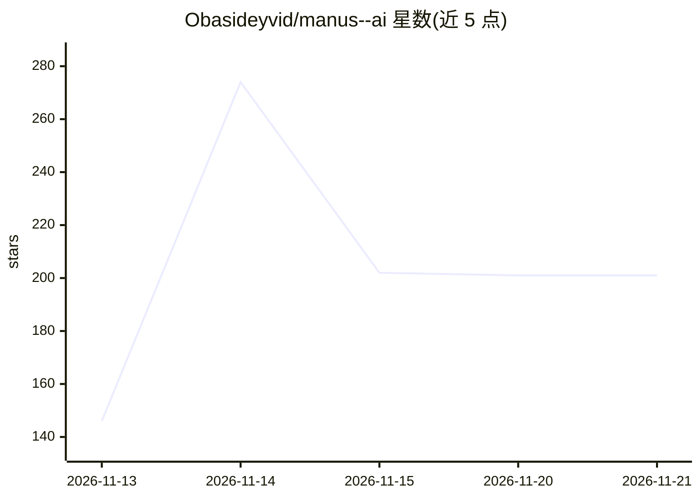

# Obasideyvid/manus--ai

⭐ 201 · Apache-2.0 · 推送 2026-11-15 · [GitHub](https://github.com/Obasideyvid/manus--ai) · 个人维护

**面向个人用户的自主 AI Agent：代跑代码与控制浏览器**

自称 Manus 的自主 AI Agent 系统，在沙盒环境中运行工具：可自主编写并执行脚本、控制浏览器（导航网页、填表、采集信息），执行多步骤任务，面向家庭、学习与轻量办公场景，无需开发背景。会话间可记忆并复用工作流模式。README 提供硬件兼容性表（最低 4GB 内存、双核 CPU）与六步上手指南，但未给出具体安装命令、代码仓库结构或 API 接入说明，仅含'Download Manus'与促销码字样，实现细节不可验证。

## 筛选速览

| 维度 | 判定 | 备注 |
|---|---|---|
| AI 角色 | `ai-native` | 本体是模型或模型工具 |
| 许可风险 | `permissive` | Apache-2.0 |
| 部署形态 | `None` |  |
| 模型依赖 | — | README 未给出锁定关系 |
| 硬件要求 | — | 无带数字的原话,不猜 |
| 安装摩擦 | `low` | 无编译、无系统依赖或容器化 |
| 成熟度 | — | 结构信号不足 |

## 能力要点

- 自主代码执行：agent 自行编写并运行脚本完成任务
- 浏览器控制：导航网页、填表、采集信息
- 代码与浏览器动作在同一工作流中衔接
- 会话间记忆工作流模式，避免重复说明

## 适用场景

- 让学生整理研究笔记、跑小型计算脚本
- 让 agent 汇总多个网页的信息用于轻量报告
- 把重复的代码与浏览器操作委托给后台 agent

## 场景标签

`编码 Agent` `浏览器自动化` `AI 助手` · 领域:效率与自动化

## 证据(README 行号)

> L10: - **Autonomous Code Execution:** Manus AI agent runs code on its own to complete tasks, so you can focus on decisio
> L18: Manus is an autonomous AI agent designed to run code and control a browser on your behalf. Instead of acting like a
> L22: Manus is not a heavy studio suite or a complex enterprise platform. It is a focused helper built for home, study, a

## 星数曲线

2026-11-13 146 → 2026-11-21 201（+55）

---
*卡片 v1 · prompt 1.4 · 生成 2026-11-17 · 置信度 mid · 依据 README sha `a3d88e202bf0` · [字段定义](../../DATASET.md)*
