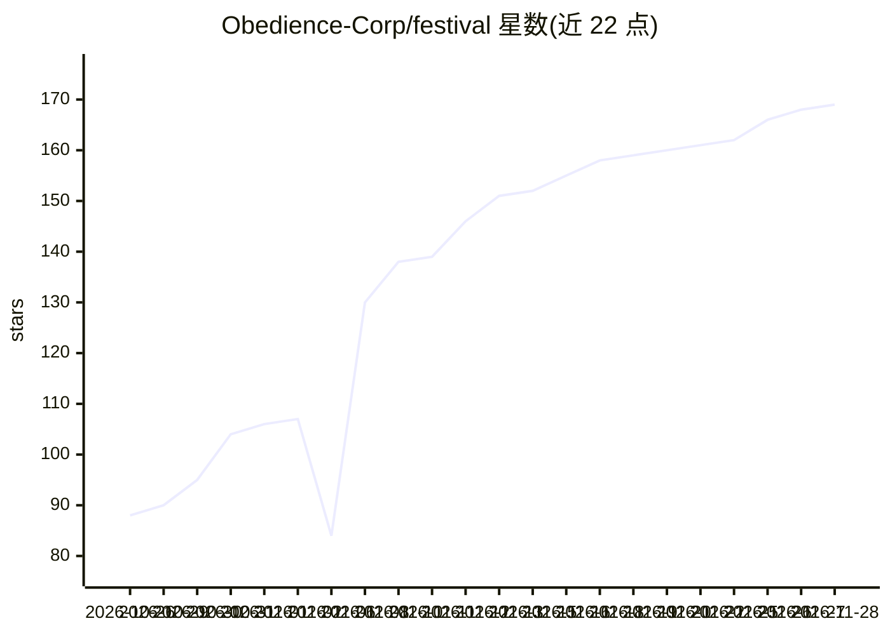

# Obedience-Corp/festival

⭐ 169 · Shell · Apache-2.0 · 推送 2026-11-24 · [GitHub](https://github.com/Obedience-Corp/festival) · [官网](https://fest.build) · 组织维护 · 中文 README

**为 AI 编码代理提供计划、上下文与监督的工程化 CLI 框架**

Festival 是一套 CLI 工具套件，由三部分组成：Fest 负责长期目标拆解为阶段与任务并经审批门推进，Camp 管理跨会话共享的工作区上下文（项目、决策、研究记录），Obey 以本地守护进程启动并监督代理会话。计划、决策与进度以文件和 Git 记录保存，可在新会话中恢复。用户保留现有编码代理，通过 fest next 循环执行工作并审查证据。需 Git；Windows 平台部分同步功能在本版本不可用。

## 筛选速览

| 维度 | 判定 | 备注 |
|---|---|---|
| AI 角色 | `ai-ecosystem` | LLM/agent 周边工具 |
| 许可风险 | `permissive` | Apache-2.0 |
| 部署形态 | `library` | 以包/库形式分发 |
| 模型依赖 | — | README 未给出锁定关系 |
| 硬件要求 | — | 无带数字的原话,不猜 |
| 安装摩擦 | `low` | 无编译、无系统依赖或容器化 |
| 成熟度 | — | 结构信号不足 |

## 能力要点

- Fest 将目标拆为阶段与任务，经审查与审批门追踪执行
- Camp 以工作区形式跨会话保存计划、决策与知识
- Obey 本地守护进程启动并监督支持的代理提供方
- fest watch 进度视图与 fest gif 生成可分享的执行回放

## 适用场景

- 让编码代理按计划循环执行功能开发并保留审查证据
- 跨多个会话延续同一目标的工作进度与上下文
- 定期让代理审查依赖变更并提交待批准的更新

## 场景标签

`编码 Agent` `Agent 框架` `Agent 记忆` · 领域:Agent 开发

## 证据(README 行号)

> L17: Festival gives you the tools to build that process through **templates and
> L121: commands, including Claude Code, Codex, Grok Build, Cursor, or OpenCode. Add Obey
> L105:     accDescr: Fest supplies plans and tracks progress. Camp shares saved context across sessions. Obey launches an

## 星数曲线

2026-10-26 88 → 2026-11-28 169（+81）

---
*卡片 v1 · prompt 1.4 · 生成 2026-11-27 · 置信度 high · 依据 README sha `c678de8b2a36` · [字段定义](../../DATASET.md)*
