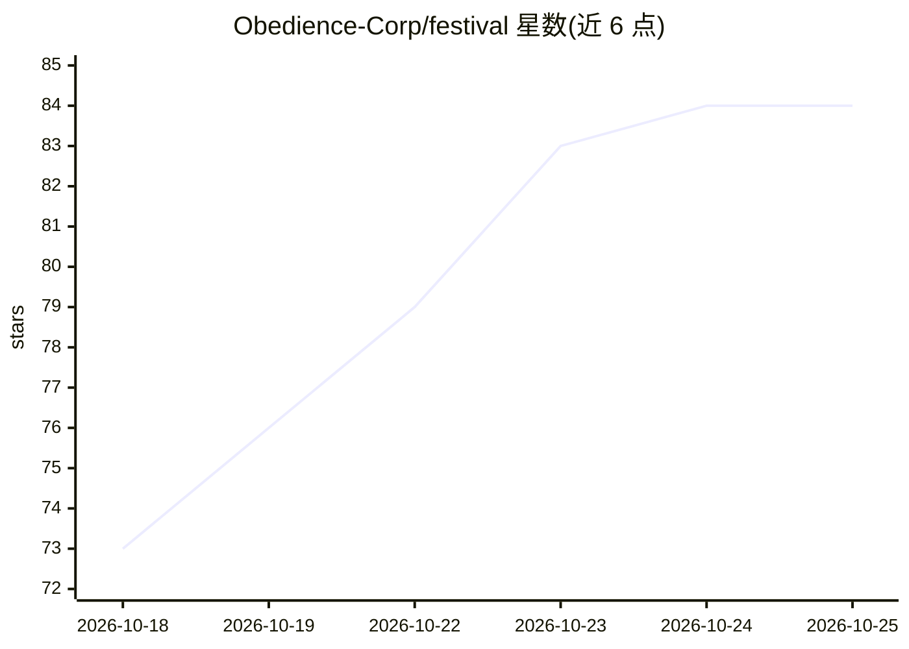

# Obedience-Corp/festival

⭐ 84 · Shell · Apache-2.0 · 推送 2026-10-23 · [GitHub](https://github.com/Obedience-Corp/festival) · [官网](https://fest.build) · 组织维护 · 中文 README

**面向 AI 编码 agent 的工作流编排框架，用文件系统与 Git 组织意图与任务循环**

Festival 是一套 vibe engineering 框架，由 camp、fest、festival 三个 CLI 工具组成。camp 管理 camp 工作区（项目、技能、规划文档、工作队列），fest 以"festival"（目标导向的工作图，含阶段/序列/任务）组织计划，agent 通过 fest next 循环推进并记录到文件与 Git。支持 Claude Code、Codex、Grok Build、Cursor、OpenCode 等能读文件和执行命令的编码 agent。提供 Homebrew、npm、Scoop 安装；Windows 版本部分同步功能不可用，需 Git 与 shell 集成。

## 筛选速览

| 维度 | 判定 | 备注 |
|---|---|---|
| AI 角色 | `ai-ecosystem` | LLM/agent 周边工具 |
| 许可风险 | `permissive` | Apache-2.0 |
| 部署形态 | `library` | 以包/库形式分发 |
| 模型依赖 | — | README 未给出锁定关系 |
| 硬件要求 | — | 无带数字的原话,不猜 |
| 安装摩擦 | `low` | 无编译、无系统依赖或容器化 |
| 成熟度 | — | 结构信号不足 |

## 能力要点

- camp/fest/festival 三工具体系：工作区、目标计划、安装管理
- fest next 循环驱动 agent 按用户设定的工作流推进任务
- 计划、检查、提交保存在文件与 Git 中，会话结束后可续接
- fest gif 可将进度记录生成为可分享的 GIF 回放

## 适用场景

- 让编码 agent 按我设定的流程完成跨仓库的功能开发
- 组织多项目工作区并在多个 camp 间切换上下文
- 追踪和审阅 agent 大规模工作时的计划、进度与验证证据

## 场景标签

`工作流自动化` `Agent 框架` · 领域:Agent 开发

## 证据(README 行号)

> L9: It uses the filesystem and Git. You configure it to your workflows and processes. When agents plan and execute, the 
> L185: A festival is a **graph of work**, organized into phases, sequences, and tasks. Each task has context and completi

## 星数曲线

2026-10-18 73 → 2026-10-25 84（+11）

---
*卡片 v1 · prompt 1.4 · 生成 2026-10-24 · 置信度 high · 依据 README sha `2f644fb5a9c5` · [字段定义](../../DATASET.md)*
