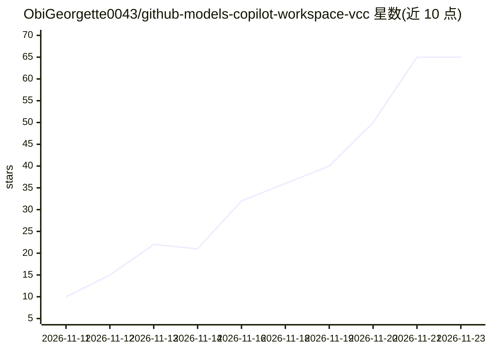

# ObiGeorgette0043/github-models-copilot-workspace-vcc

⭐ 65 · 推送 2026-11-11 · [GitHub](https://github.com/ObiGeorgette0043/github-models-copilot-workspace-vcc) · 个人维护 · 中文 README

**推广 CoreGold 虚拟卡用于 GitHub Copilot/Models 结算的营销指南**

以'2026 实战指南'形式呈现的 CoreGold 商业虚拟卡（VCC）推广文档：解释 GitHub 组织结算拒付原因（发卡行资质、弹性划扣风控、AVS 地址匹配），对比国内双币卡与 CoreGold VCC，并给出 USDT 充值、开卡、在 GitHub Billing 录入卡片的操作步骤。全文不含代码、安装方式或可运行软件，末尾附推广链接与哈希串，本质为引流广告而非技术项目。

## 筛选速览

| 维度 | 判定 | 备注 |
|---|---|---|
| AI 角色 | `ai-knowledge` | 知识聚合/清单类 |
| 许可风险 | `none` | — |
| 部署形态 | `None` |  |
| 模型依赖 | — | README 未给出锁定关系 |
| 硬件要求 | — | 无带数字的原话,不猜 |
| 安装摩擦 | `low` | 无编译、无系统依赖或容器化 |
| 成熟度 | — | 结构信号不足 |

## 能力要点

- 介绍 GitHub 组织多席位结算被拒付的三类风控原因
- 给出 USDT 注资、生成商业 VCC、录入 GitHub 账单信息的三步流程
- 提供个人双币卡与 CoreGold VCC 的对比表

## 适用场景

- 了解 GitHub 组织结算拒付的常见风控机制
- 按步骤开通 CoreGold 虚拟卡并绑定 GitHub 账单（内容为商业推广）

## 场景标签

 · 领域:支付服务/营销内容

## 证据(README 行号)

> L2: ⚡ 2026 实战指南：手把手教你用 CoreGold 商业 VCC 搞定 GitHub Copilot &amp; Models 结算
> L8: 👉 **立即进入 CoreGold 官方开卡控制台**
> L55: 👉 **点击注册并进入 CoreGold 官方发卡后台**
> L56: cc1cd4897407944f8d432a23483594ad

## 星数曲线

2026-11-11 10 → 2026-11-23 65（+55）

---
*卡片 v1 · prompt 1.4 · 生成 2026-11-18 · 置信度 high · 依据 README sha `8554446634a1` · [字段定义](../../DATASET.md)*
