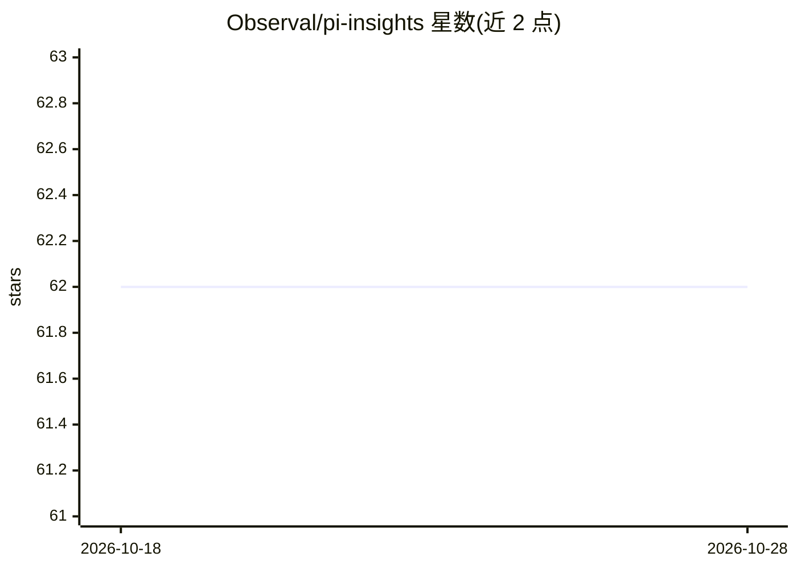

# Observal/pi-insights

⭐ 62 · TypeScript · AGPL-3.0 · 推送 2026-05-27 · [GitHub](https://github.com/Observal/pi-insights) · [官网](https://www.npmjs.com/package/@observal/pi-insights) · 组织维护

**Pi 编码代理的个人使用分析扩展：扫描会话生成洞察报告**

Observal 团队开发的 Pi coding agent 扩展，扫描用户的会话历史日志，先确定性地提取 token、成本、工具错误、git 活动等统计，再用 LLM 抽取目标/结果/满意度/摩擦等侧面，经衰减加权聚合、异常检测与趋势识别后，生成自包含的 HTML 报告。报告含周环比变化、上下文感知的功能建议（读取 AGENTS.md、已装技能）、'停止做'反模式清单与模型支出效率分析。结果缓存在 ~/.pi/agent/usage-data/。要求 Pi v0.74.0+ 且已配置模型。

## 筛选速览

| 维度 | 判定 | 备注 |
|---|---|---|
| AI 角色 | `ai-ecosystem` | LLM/agent 周边工具 |
| 许可风险 | `viral` | AGPL-3.0 |
| 部署形态 | `None` |  |
| 模型依赖 | — | README 未给出锁定关系 |
| 硬件要求 | — | 无带数字的原话,不猜 |
| 安装摩擦 | `low` | 无编译、无系统依赖或容器化 |
| 成熟度 | — | 结构信号不足 |

## 能力要点

- 五阶段流水线：扫描→确定性统计→LLM 抽取→衰减加权聚合→8 并行 LLM 提示生成洞察
- 时间感知：周环比 diff、10 天半衰期衰减图表、轨迹与异常检测
- 上下文感知建议：读取 AGENTS.md/已装技能，避免重复建议，并给出负面建议
- 模型支出分析：识别过支与欠支并估算节省

## 适用场景

- 回顾数百个 Pi 会话中的使用模式、成本与摩擦点
- 发现哪些模式在浪费时间或金钱并获得替代方案
- 决定不同任务该用哪个模型以优化支出

## 场景标签

`LLM 可观测性` · 领域:评测与运维

## 证据(README 行号)

> L5: Personal usage analytics for the Pi coding agent. Scans your session history, extracts deterministic stats and LLM-p
> L100: 1. **Scan** all Pi session log files
> L102: 3. **LLM facet extraction** per session to classify goals, outcomes, satisfaction, and friction

## 星数曲线

2026-10-18 62 → 2026-10-28 62（+0）

---
*卡片 v1 · prompt 1.4 · 生成 2026-10-24 · 置信度 high · 依据 README sha `df307c240980` · [字段定义](../../DATASET.md)*
