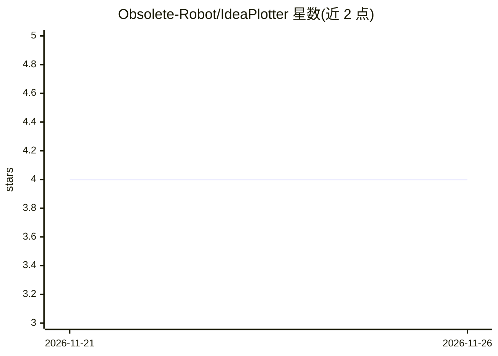

# Obsolete-Robot/IdeaPlotter

⭐ 4 · Python · MIT · 推送 2026-11-03 · [GitHub](https://github.com/Obsolete-Robot/IdeaPlotter) · [官网](https://obsoleterobot.com/ideaplotter/) · 个人维护

**把 Steam 全目录绘成语义地图，AI 撰写空白点游戏创意**

本地运行的 Python 应用：抓取 Steam 商店页文本，用 Qwen3-Embedding-0.6B（1024 维）将约 18.9 万款游戏嵌入向量空间并提供 2D/3D 可视化地图；提供四种寻找空白点的方式（空洞环、圈选区域、混合 2–8 款游戏、全局搜索），随后由 AI 撰写商店页草稿，嵌入后以 target_sim/nearest_sim 等指标测量并循环修订，按 novelty 与 isolation 排序输出到 out/ideas/。附 CLI 批量命令与自托管 serve 模式。AI 写手为可选项，可先浏览地图后补配置。

## 筛选速览

| 维度 | 判定 | 备注 |
|---|---|---|
| AI 角色 | `ai-native` | 本体是模型或模型工具 |
| 许可风险 | `permissive` | MIT |
| 部署形态 | `desktop` | 安装包/桌面程序 |
| 模型依赖 | locked-api |  |
| 硬件要求 | — | 无带数字的原话,不猜 |
| 安装摩擦 | `medium` | 含编译或系统依赖之一 |
| 成熟度 | — | 结构信号不足 |

## 能力要点

- 约 18.9 万款 Steam 游戏的 1024 维语义地图，预构建快照约 440 MB 下载即用
- 四种空白点搜索方式：空洞环、区域圈选、游戏混合、全局最空点
- AI 撰写→嵌入测量→修订的闭环，按 novelty/isolation 排序创意
- 支持 OpenRouter/Anthropic/Claude Code 多种写手，CLI 批量与自托管 serve

## 适用场景

- 在语义地图上找没人做过的游戏设计方向
- 混合几款喜欢的游戏生成新游戏点子
- 批量导出 Steam 全目录最空的 40 个点位及创意报告
- 自建服务器向他人提供地图浏览服务

## 场景标签

`语义搜索` `AI 写作` · 领域:内容生成

## 证据(README 行号)

> L3: Plot every game on Steam in a semantic vector space, find the empty places, and turn them into new game ideas, ranke
> L7: Every point of light on the map is a Steam game, placed by what its store page says, so similar games sit together. 
> L89: Steam catalog ──► store pages ──► embeddings ──► find voids ──► LLM writes a game ──► embed it, measure, revise

## 星数曲线

2026-11-21 4 → 2026-11-26 4（+0）

---
*卡片 v1 · prompt 1.4 · 生成 2026-11-21 · 置信度 high · 依据 README sha `0e96f044ae17` · [字段定义](../../DATASET.md)*
