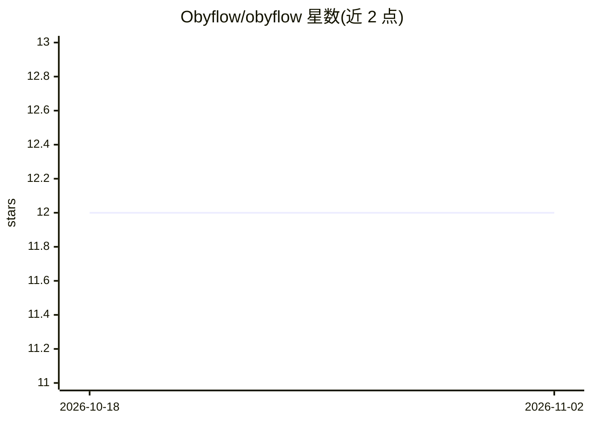

# Obyflow/obyflow

⭐ 12 · TypeScript · MIT · 推送 2026-11-01 · [GitHub](https://github.com/Obyflow/obyflow) · [官网](https://obyflowapp.onrender.com) · 个人维护

**CLI 优先的 AI 应用可观测性工具：本地追踪与 LLM 辅助根因排查**

面向开发者的终端可观测性工具：通过 Node.js 与 Python SDK 对应用埋点，将追踪、日志、指标、LLM 调用、向量库查询、LangChain 步骤等结构化事件存入本地 SQLite，连接成分布式追踪，支持异常检测、变更追踪与事故历史检索；可接入自选 LLM（Gemini/Anthropic/OpenAI/Ollama 或无 LLM 的纯证据模式）基于遥测数据开展调查。数据本地存储，无需外部后端，可导出 JSON/CSV/OTLP。Node 端需编译 better-sqlite3 原生扩展。

## 筛选速览

| 维度 | 判定 | 备注 |
|---|---|---|
| AI 角色 | `ai-ecosystem` | LLM/agent 周边工具 |
| 许可风险 | `permissive` | MIT |
| 部署形态 | `library` | 以包/库形式分发 |
| 模型依赖 | local-ok | 支持本地模型 |
| 硬件要求 | — | 无带数字的原话,不猜 |
| 安装摩擦 | `medium` | 含编译或系统依赖之一 |
| 成熟度 | — | 结构信号不足 |

## 能力要点

- LLM 调用、向量库查询、LangChain 步骤的结构化追踪与分布式追踪传播
- LLM 辅助根因调查，支持 gemini/anthropic/openai/ollama 或纯证据模式
- 本地 SQLite 存储无外部后端，含脱敏与 OpenTelemetry OTLP 导出
- Node/Python 双 SDK，Python 侧含 IsolationForest 异常检测

## 适用场景

- 在终端里排查 LLM 链路失败、工具超时与慢向量查询
- 跨服务请求追踪与部署间变更对比定位事故原因
- 统计 LLM token、成本与上下文用量

## 场景标签

`LLM 可观测性` · 领域:评测与运维

## 证据(README 行号)

> L3: **AI-native, CLI-first observability for modern applications.** Trace and debug LLM calls, vector-store queries, and
> L5: Obyflow stores structured events locally in SQLite, connects them into traces, and can use an LLM of your choice to 
> L31: - **AI investigations** — Investigate traces and incidents using your telemetry as evidence.

## 星数曲线

2026-10-18 12 → 2026-11-02 12（+0）

---
*卡片 v1 · prompt 1.4 · 生成 2026-11-01 · 置信度 high · 依据 README sha `28f5e480de6d` · [字段定义](../../DATASET.md)*
