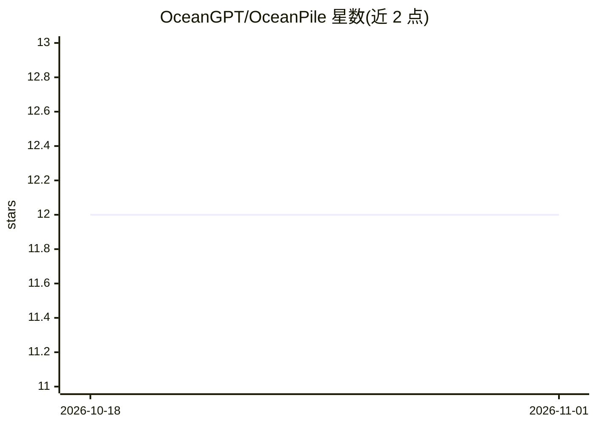

# OceanGPT/OceanPile

⭐ 12 · Python · MIT · 推送 2026-05-18 · [GitHub](https://github.com/OceanGPT/OceanPile) · [官网](http://data.oceangpt.blue/en/) · 组织维护

**面向海洋领域基础模型的大规模多模态语料与基准集合**

由 zjunlp 团队（浙江大学相关作者）发布的海洋智能语料项目，含三个部分：OceanCorpus（汇聚声呐数据、水下图像、海洋科学图像与科学文本，30 万+ PDF、50B+ tokens）、OceanInstruction（由海洋概念知识图谱引导的流水线合成的指令数据集，14 万+ 样本）、OceanBench（人工整理的评测基准，1,469 样本）。另发布 4 个基于该语料训练的 OceanGPT 模型（海洋科学 VQA/QA、声呐图像 VQA、海洋生物 VQA），数据与模型托管于 Hugging Face，数据集以 MIT 许可发布。

## 筛选速览

| 维度 | 判定 | 备注 |
|---|---|---|
| AI 角色 | `ai-knowledge` | 知识聚合/清单类 |
| 许可风险 | `permissive` | MIT |
| 部署形态 | `library` | 以包/库形式分发 |
| 模型依赖 | — | README 未给出锁定关系 |
| 硬件要求 | — | 无带数字的原话,不猜 |
| 安装摩擦 | `low` | 无编译、无系统依赖或容器化 |
| 成熟度 | — | 结构信号不足 |

## 能力要点

- OceanCorpus 汇聚声呐、水下图像与科学文本，超 30 万 PDF 文档、50B+ tokens
- OceanInstruction 由层级化海洋概念知识图谱引导合成，含 141,124 样本
- OceanBench 人工整理评测基准（1,469 样本），提供 API 与本地模型两种评测脚本
- 配套发布 4 个 OceanGPT 多模态/文本模型，支持 Transformers 加载推理

## 适用场景

- 为海洋领域基础模型的预训练与指令微调获取数据
- 评测海洋科学 VQA/QA 模型的表现
- 下载 OceanGPT 模型做海洋科学问答或声呐图像理解推理

## 场景标签

`模型评测` · 领域:评测与运维

## 证据(README 行号)

> L5: **OceanPile**, a large-scale multimodal corpus designed for ocean intelligence. It comprises three key components: *
> L23: |OceanCorpus|-|&gt; 300K PDF documents|&gt; 50B|🤗 Download|

## 星数曲线

2026-10-18 12 → 2026-11-01 12（+0）

---
*卡片 v1 · prompt 1.4 · 生成 2026-11-01 · 置信度 high · 依据 README sha `c5f2d60e2c7f` · [字段定义](../../DATASET.md)*
