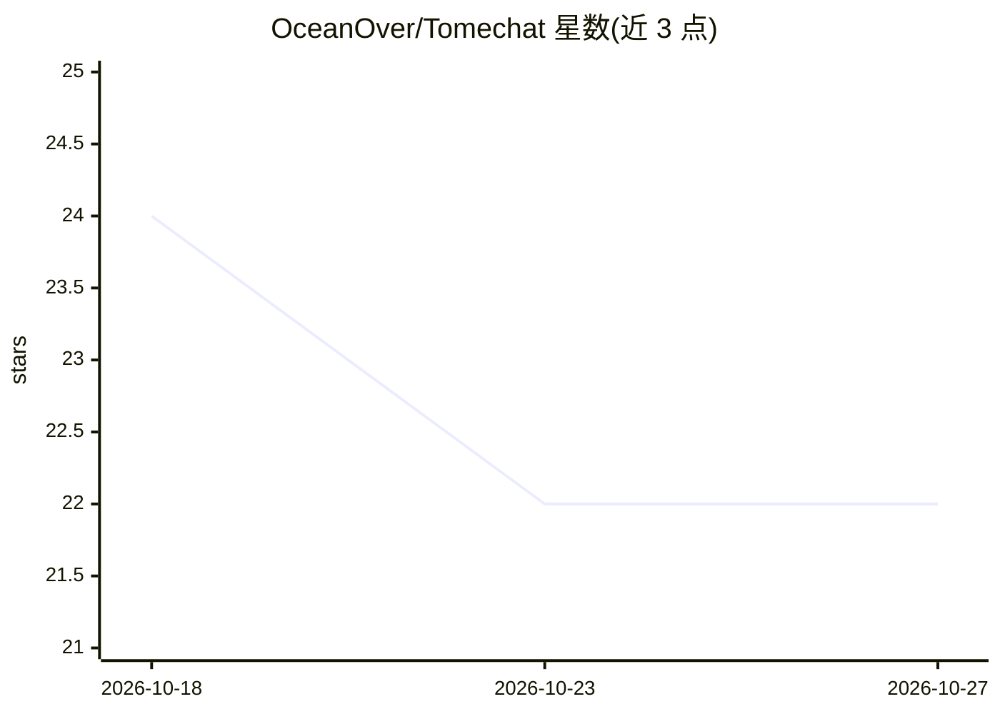

# OceanOver/Tomechat

⭐ 22 · TypeScript · MIT · 推送 2026-10-14 · [GitHub](https://github.com/OceanOver/Tomechat) · 个人维护 · 中文 README

**基于 LangChain 与远程 LLM API 的 RAG 知识库聊天应用**

面向使用者的聊天应用：通过 OpenAI 兼容 API 或 Google Gemini 原生 SDK 调用远程模型，在 LangChain 框架上实现基于 FAISS 向量检索的本地知识库问答，另支持 Tavily/SearxNG 联网搜索增强对话。架构为 FastAPI 后端（唯一模型网关，统一持有密钥）+ Next.js 前端 + SQLite/FAISS 存储。LLM 与 embedding 服务可分别配置不同提供方。不部署本地模型与 GPU 运行时，不含 reranker 与多模态。源码安装需 Python 3.10+/Node 20+/uv/pnpm，亦提供 Docker Compose 部署。前端含 LobeChat 衍生代码并单独授权。

## 筛选速览

| 维度 | 判定 | 备注 |
|---|---|---|
| AI 角色 | `ai-native` | 本体是模型或模型工具 |
| 许可风险 | `permissive` | MIT |
| 部署形态 | `self-host` | docker 或自建部署 |
| 模型依赖 | — | README 未给出锁定关系 |
| 硬件要求 | — | 无带数字的原话,不猜 |
| 安装摩擦 | `low` | 无编译、无系统依赖或容器化 |
| 成熟度 | — | 结构信号不足 |

## 能力要点

- OpenAI 兼容 API 或 Gemini 原生 SDK 接入远程模型
- FAISS 向量检索的本地知识库问答与管理（CRUD、文档向量化）
- FastAPI 作为唯一模型网关，前端不持有密钥
- 支持 Tavily/SearxNG 搜索引擎增强对话

## 适用场景

- 搭建自己的知识库问答聊天应用
- 用不同提供方分别配置 LLM 与 embedding 服务
- 通过 Docker Compose 自托管部署

## 场景标签

`聊天机器人` `文档问答` · 领域:对话与助手

## 证据(README 行号)

> L3: RAG knowledge-base chat application built on the LangChain framework and remote LLM APIs.
> L15: Tomechat is a chatbot that connects to remote model services through OpenAI-compatible APIs (or the Google Gemini n
> L30: |Knowledge-base RAG|Local knowledge-base Q&A based on FAISS vector retrieval|

## 星数曲线

2026-10-18 24 → 2026-10-27 22（-2）

---
*卡片 v1 · prompt 1.4 · 生成 2026-10-27 · 置信度 high · 依据 README sha `742c96056805` · [字段定义](../../DATASET.md)*
