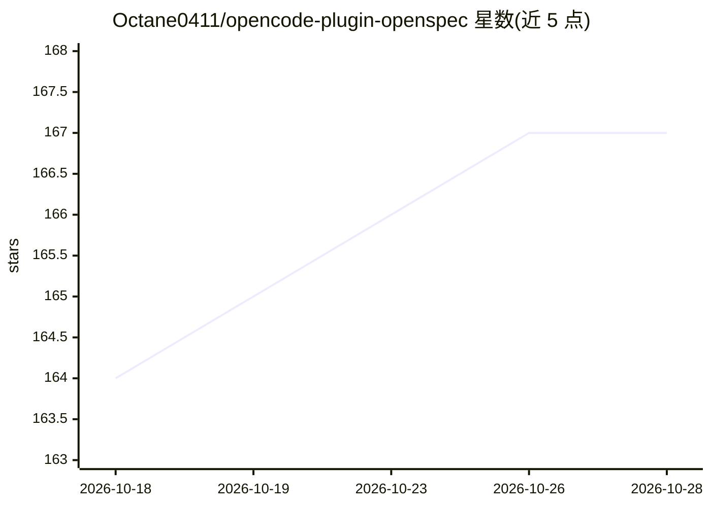

# Octane0411/opencode-plugin-openspec

⭐ 167 · TypeScript · MIT · 推送 2026-03-24 · [GitHub](https://github.com/Octane0411/opencode-plugin-openspec) · 个人维护

**OpenCode 插件：新增 openspec-plan 模式专用于规格规划**

为 OpenCode 提供的插件，集成了名为 OpenSpec Architect 的专用 agent（openspec-plan 模式），用于创建和编辑 OpenSpec 规划文档（project.md、AGENTS.md、openspec/**、specs/**），同时禁止修改实现代码，其余代码库保持只读。解决的问题：标准 Build 模式下 agent 常在规划未完成时就开始写代码。安装方式为在 opencode.json 的 plugin 数组中添加包名，OpenCode 下次运行时自动下载，无需手动 npm install。面向使用 OpenSpec 做规格驱动开发的开发者。

## 筛选速览

| 维度 | 判定 | 备注 |
|---|---|---|
| AI 角色 | `ai-ecosystem` | LLM/agent 周边工具 |
| 许可风险 | `permissive` | MIT |
| 部署形态 | `library` | 以包/库形式分发 |
| 模型依赖 | — | README 未给出锁定关系 |
| 硬件要求 | — | 无带数字的原话,不猜 |
| 安装摩擦 | `low` | 无编译、无系统依赖或容器化 |
| 成熟度 | — | 结构信号不足 |

## 能力要点

- 新增 openspec-plan 专用 agent 模式
- 自动检测工作区是否为 OpenSpec 项目
- 仅对规格文件授予写权限，其余代码库只读
- 通过 opencode.json 配置即装，OpenCode 自动下载

## 适用场景

- 在 OpenCode 中做架构规划而不被 agent 提前改代码
- 规格驱动开发（SDD）流程中分离设计与实现
- 让 LLM agent 代为完成插件配置安装

## 场景标签

`Agent 框架` · 领域:Agent 开发

## 证据(README 行号)

> L3: An OpenCode plugin that integrates OpenSpec, providing a dedicated agent for planning and specifying software archit
> L13: `opencode-plugin-openspec` introduces a specialized **OpenSpec Architect** agent. This agent is configured to:

## 星数曲线

2026-10-18 164 → 2026-10-28 167（+3）

---
*卡片 v1 · prompt 1.4 · 生成 2026-10-22 · 置信度 mid · 依据 README sha `db72dec18007` · [字段定义](../../DATASET.md)*
