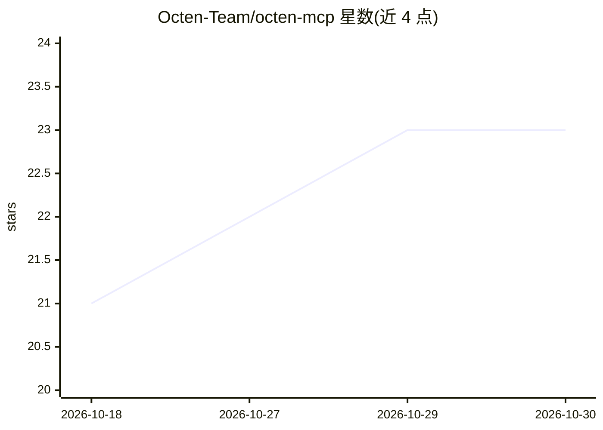

# Octen-Team/octen-mcp

⭐ 23 · JavaScript · MIT · 推送 2026-10-29 · [GitHub](https://github.com/Octen-Team/octen-mcp) · [官网](https://docs.octen.ai/integrations/octen-mcp-server) · 组织维护

**给 MCP 客户端的 Octen 联网搜索/网页抽取服务器**

为 Octen 服务提供 MCP server，可接入 Claude Code、Cursor、VS Code、Codex、Windsurf 等任意 MCP 客户端，向 agent 提供六种工具：search、news_search、broad_search（多子查询并发搜索）、extract（URL 转 LLM 就绪内容，附 category/page_structure/highlights）、以及 Beta 阶段的 image_search 与 video_search。支持托管端点（OAuth 或 API key）与本地 npx 两种接入方式；本地运行需 Node >= 18.17。搜索等核心功能依赖 octen.ai 的 API key 或 OAuth 登录。

## 筛选速览

| 维度 | 判定 | 备注 |
|---|---|---|
| AI 角色 | `ai-ecosystem` | LLM/agent 周边工具 |
| 许可风险 | `permissive` | MIT |
| 部署形态 | `library` | 以包/库形式分发 |
| 模型依赖 | — | README 未给出锁定关系 |
| 硬件要求 | — | 无带数字的原话,不猜 |
| 安装摩擦 | `low` | 无编译、无系统依赖或容器化 |
| 成熟度 | `idea` | |

## 能力要点

- 六种工具：网页/新闻/多角度搜索、URL 抽取、图片与视频搜索（后两者为 Beta）
- extract 返回 category、page_structure 与排序 highlights，供 agent 预筛内容
- 托管端点与本地 npx 双接入，支持 OAuth 或 API key 认证
- 提供 Claude Code 插件安装与各主流 MCP 客户端的配置说明

## 适用场景

- 给我的编程 agent 联网搜索与网页抽取能力
- 在 RAG 或研究流程中把 URL 转成干净的 LLM 可用内容
- 用 broad_search 做多角度资料检索

## 场景标签

`网页抓取` · 领域:效率与自动化

## 证据(README 行号)

> L8: MCP server for **Octen**. Plug it into Claude, Cursor, VS Code, Windsurf, or any MCP client to give your agent live 
> L12: - **`search` / `news_search`**: search the live web with domain, text, language, and time filters.

## 星数曲线

2026-10-18 21 → 2026-10-30 23（+2）

---
*卡片 v1 · prompt 1.4 · 生成 2026-10-27 · 置信度 high · 依据 README sha `f0868bd35028` · [字段定义](../../DATASET.md)*
