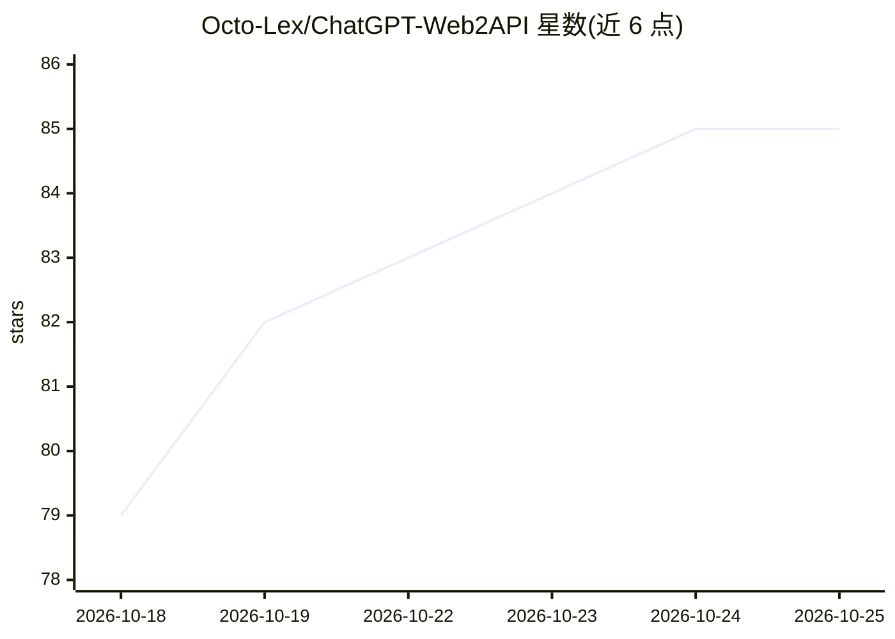

# Octo-Lex/ChatGPT-Web2API

⭐ 85 · Python · MIT · 推送 2026-10-22 · [GitHub](https://github.com/Octo-Lex/ChatGPT-Web2API) · 个人维护

**把 ChatGPT 网页版封装成 OpenAI 兼容 API 与 MCP 服务的代理**

面向持有 ChatGPT Plus 订阅、希望以编程方式使用 ChatGPT 的开发者：通过 CDP 驱动真实 Chrome 浏览器登录 chatgpt.com，模拟人工输入与点击读取回答，对外暴露三种接口——OpenAI 兼容 REST API（可用 OpenAI SDK 直接替换 base_url）、含 16 个工具的 MCP 服务器（SSE/stdio 传输）、以及命令行。支持项目记忆与对话的 CRUD、Custom GPT 对话、限流自动重试与 429 语义化信号，附 doctor 命令诊断网页 API 变动。限制：SSE 传输下多客户端共享单个浏览器会话，尚不支持并行独立 agent 会话（待 B1）；MCP 写入/删除类工具需环境变量分级解锁。pip 安装，需 Python 3.11+ 与本地 Chrome。

## 筛选速览

| 维度 | 判定 | 备注 |
|---|---|---|
| AI 角色 | `ai-ecosystem` | LLM/agent 周边工具 |
| 许可风险 | `permissive` | MIT |
| 部署形态 | `desktop` | 安装包/桌面程序 |
| 模型依赖 | — | README 未给出锁定关系 |
| 硬件要求 | — | 无带数字的原话,不猜 |
| 安装摩擦 | `low` | 无编译、无系统依赖或容器化 |
| 成熟度 | — | 结构信号不足 |

## 能力要点

- CDP 驱动真实 Chrome 处理反机器人挑战，无需 token 提取
- OpenAI 兼容 REST API + 16 工具 MCP 服务器（SSE/stdio）
- ChatGPT 项目、记忆、对话、Custom GPT 的程序化管理
- 限流弹窗自动重试并转为标准 429 + Retry-After 信号

## 适用场景

- 用 OpenAI SDK 或 LangChain 等框架直接调用 ChatGPT 订阅而无需 API key
- 让 Claude Desktop、Cursor 等 MCP 客户端把 ChatGPT 作为工具调用
- 从代码管理 ChatGPT 项目、记忆与对话

## 场景标签

`浏览器自动化` `模型网关` · 领域:Agent 开发

## 证据(README 行号)

> L7: One command starts a Chrome browser, logs into ChatGPT, and exposes an OpenAI-compatible API + MCP server.
> L69: Drop-in replacement for `api.openai.com`:
> L152: Expose ChatGPT to Claude Desktop, Cursor, Craft Agent, or any MCP client. Two

## 星数曲线

2026-10-18 79 → 2026-10-25 85（+6）

---
*卡片 v1 · prompt 1.4 · 生成 2026-10-24 · 置信度 high · 依据 README sha `be52ddbab472` · [字段定义](../../DATASET.md)*
