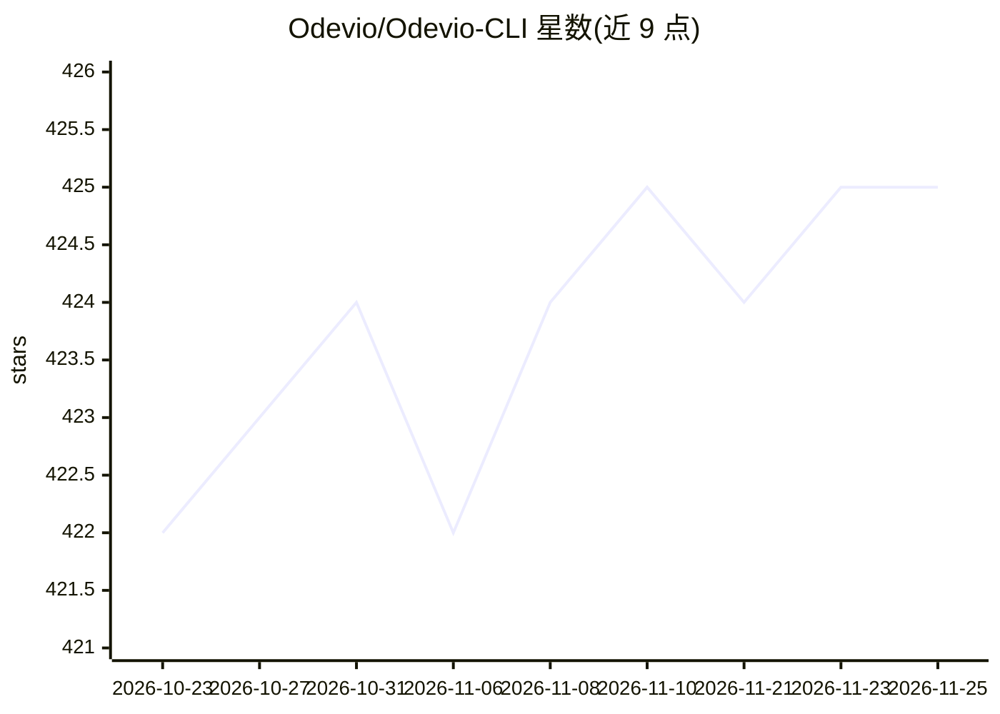

# Odevio/Odevio-CLI

⭐ 425 · Python · MIT · 推送 2026-11-20 · [GitHub](https://github.com/Odevio/Odevio-CLI) · [官网](https://www.odevio.com) · 组织维护

**让 AI 代理在任意系统上构建、签名并发布 iOS 应用**

Odevio 是一个 Python 编写的 CLI 工具，通过远程 Mac 机器完成 Flutter 应用的 iOS 构建、证书与描述文件管理、IPA 打包，并可发布到 TestFlight 和 App Store，用户无需拥有 Mac 或 Xcode。既可由 AI 代理驱动——通过 odevio skill install 为 Claude Code、Codex、Cursor、Gemini 等安装技能，由代理以自然语言完成整个流程；也可作为普通 CLI 手动使用（signup、apple add、build start 等命令）。构建失败时可查看日志。

## 筛选速览

| 维度 | 判定 | 备注 |
|---|---|---|
| AI 角色 | `ai-enhanced` | 去掉 AI 部分产品仍成立 |
| 许可风险 | `permissive` | MIT |
| 部署形态 | `library` | 以包/库形式分发 |
| 模型依赖 | locked-api |  |
| 硬件要求 | — | 无带数字的原话,不猜 |
| 安装摩擦 | `low` | 无编译、无系统依赖或容器化 |
| 成熟度 | — | 结构信号不足 |

## 能力要点

- 在远程 Mac 上构建并签名 iOS 应用，无需本地 Mac 与 Xcode
- 通过 odevio skill install 为 Claude Code/Codex/Cursor/Gemini 安装代理技能
- 管理证书、设备、描述文件、bundle ID 与 Xcode 配置
- 支持 ad-hoc IPA 构建与发布到 TestFlight/App Store

## 适用场景

- 在 Linux/Windows 上为 Flutter 项目产出可安装的 iOS IPA
- 让 AI 代理根据自然语言请求完成构建、修错并发布到 TestFlight
- 不熟悉 iOS 证书体系的开发者完成签名与上架流程

## 场景标签

 · 领域:移动开发/构建发布工具

## 证据(README 行号)

> L27: Odevio lets an AI agent build and publish your iOS apps for you. It runs the build and signing on
> L41: The way to use Odevio is to let your AI agent drive it. Install the skill once (this sets up Claude Code,
> L122: #. It builds your Flutter app on remote Macs, so you need no Mac of your own.

## 星数曲线

2026-10-23 422 → 2026-11-25 425（+3）

---
*卡片 v1 · prompt 1.4 · 生成 2026-11-25 · 置信度 high · 依据 README sha `b4d966c5f228` · [字段定义](../../DATASET.md)*
