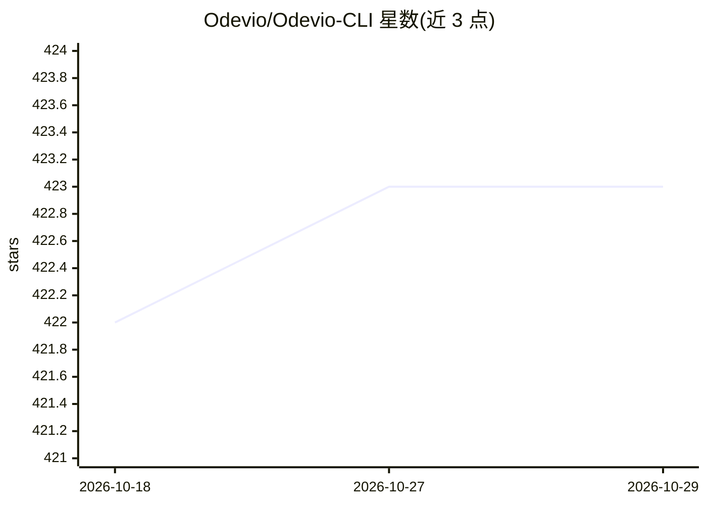

# Odevio/Odevio-CLI

⭐ 423 · Python · MIT · 推送 2026-10-23 · [GitHub](https://github.com/Odevio/Odevio-CLI) · [官网](https://www.odevio.com) · 组织维护

**无需 Mac/Xcode，通过 AI agent 在远程 Mac 构建、签名并发布 iOS 应用**

Python 编写的 CLI 工具，面向 Flutter 开发者：将 iOS 构建、代码签名、证书/描述文件管理、打包 IPA 与发布到 TestFlight/App Store 的流程放在远程 Mac 上执行，用户本地无需 Mac 与 Xcode。可由 Claude Code 等 AI agent 驱动（通过 odevio skill install 安装技能），也可直接以 CLI 命令操作。构建失败时可查看日志。需注册 Odevio 账号并关联 Apple Developer 账户。

## 筛选速览

| 维度 | 判定 | 备注 |
|---|---|---|
| AI 角色 | `ai-ecosystem` | LLM/agent 周边工具 |
| 许可风险 | `permissive` | MIT |
| 部署形态 | `library` | 以包/库形式分发 |
| 模型依赖 | — | README 未给出锁定关系 |
| 硬件要求 | — | 无带数字的原话,不猜 |
| 安装摩擦 | `low` | 无编译、无系统依赖或容器化 |
| 成熟度 | — | 结构信号不足 |

## 能力要点

- 在远程 Mac 上完成 iOS 构建、签名与发布，本地无需 Mac/Xcode
- 管理证书、设备、描述文件、bundle ID 等 iOS 细节
- 支持 Claude Code agent 驱动整个流程（odevio skill install）
- 支持 ad-hoc IPA 打包与发布到 TestFlight/App Store

## 适用场景

- 没有 Mac 的 Flutter 开发者构建并发布 iOS 应用
- 让 AI agent 用自然语言指令完成 iOS 打包与上架
- 在任意操作系统上处理 iOS 证书与签名配置

## 场景标签

 · 领域:移动应用构建/发布工具

## 证据(README 行号)

> L27: Odevio lets an AI agent build and publish your iOS apps for you. It runs the build and signing on
> L41: The way to use Odevio is to let your AI agent drive it. Install the skill once (this sets up Claude Code,
> L109: #. It lets an AI agent such as Claude Code drive the whole flow from plain-language requests.

## 星数曲线

2026-10-18 422 → 2026-10-29 423（+1）

---
*卡片 v1 · prompt 1.4 · 生成 2026-10-21 · 置信度 high · 依据 README sha `c4e809a31b94` · [字段定义](../../DATASET.md)*
