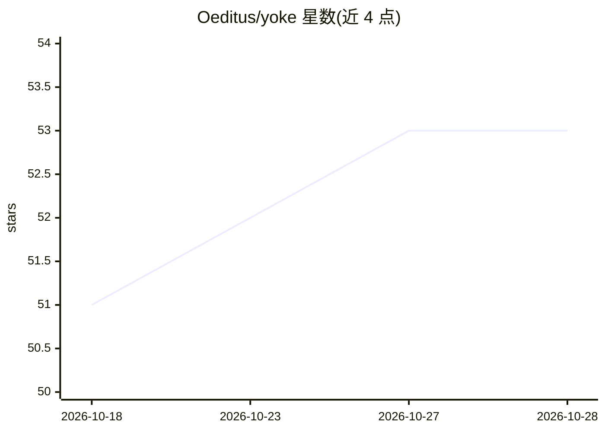

# Oeditus/yoke

⭐ 54 · Elixir · NOASSERTION · 推送 2026-10-28 · [GitHub](https://github.com/Oeditus/yoke) · [官网](https://yoke.yokerhood.com/) · 个人维护

**面向开发者的 CLI 编码 agent 终端，原生支持 DeepSeek/OpenRouter/本地模型**

用 Elixir/Erlang OTP 构建的终端 agentic 编码工具，默认接入 DeepSeek 官方 API（deepseek-flash/coder/reasoner），原生支持 OpenRouter、OpenCode Go 及本地推理引擎（SGLang/Ollama/LM Studio/vLLM），本地回环端点无需 API key。核心机制基于 BEAM 进程隔离：Brain/Hands 分离、OTP 监督树容错、工具执行前后快照与 /undo 回滚、热重载插件、并行子 agent。支持推理链流式输出与静默模式切换、会话持久化恢复（lmml 格式）、MCP 服务器挂载。工具可在本地、远程 Erlang 节点或 Docker 容器中执行。

## 筛选速览

| 维度 | 判定 | 备注 |
|---|---|---|
| AI 角色 | `ai-native` | 本体是模型或模型工具 |
| 许可风险 | `none` | NOASSERTION |
| 部署形态 | `desktop` | 安装包/桌面程序 |
| 模型依赖 | local-ok | 支持本地模型 |
| 硬件要求 | — | 无带数字的原话,不猜 |
| 安装摩擦 | `medium` | 含编译或系统依赖之一 |
| 成熟度 | — | 结构信号不足 |

## 能力要点

- Brain/Hands 进程分离架构，OTP 监督树隔离工具执行故障
- 支持 DeepSeek 官方 API、OpenRouter 及 SGLang/Ollama/LM Studio/vLLM 本地推理
- 状态快照与 /undo 回滚、插件热重载、并行子 agent 会话
- 推理/静默双模式，自动解析 <think> 推理标签

## 适用场景

- 在终端里让 AI agent 执行编码、调试与重构任务
- 切换使用 DeepSeek、OpenRouter 或完全离线的本地模型
- 跨重启恢复历史会话，对工具执行结果做撤销与分支

## 场景标签

`编码 Agent` · 领域:编码与开发

## 证据(README 行号)

> L4:  An agentic CLI coding harness (originally built for DeepSeek models,) purely on Elixir &amp; Erlang/OTP
> L11: An agentic CLI coding harness for **DeepSeek** models (`deepseek-chat` V3, `deepseek-coder` V2.5, and `deepseek-rea
> L121: While `yoke` defaults to the official remote **DeepSeek API** (`https://api.deepseek.com/chat/completions` with `d

## 星数曲线

2026-10-18 51 → 2026-10-28 53（+2）

---
*卡片 v1 · prompt 1.4 · 生成 2026-10-24 · 置信度 high · 依据 README sha `2b18ad57c7b0` · [字段定义](../../DATASET.md)*
