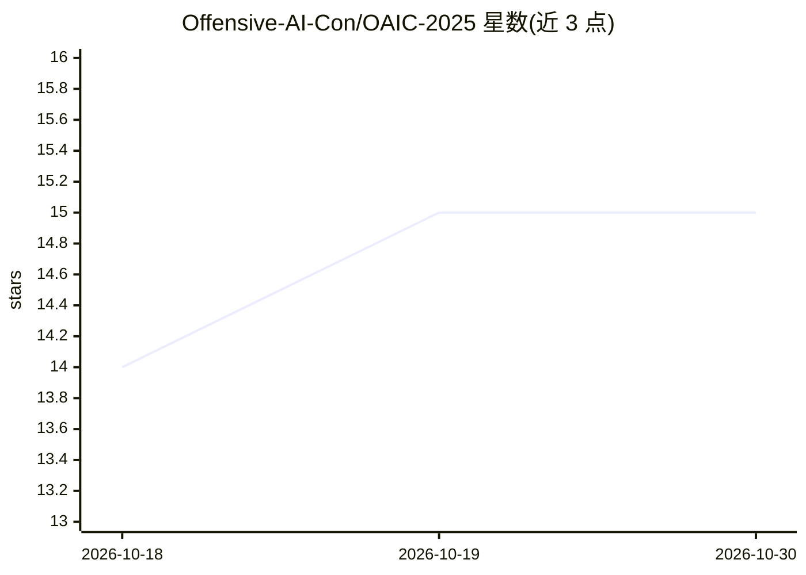

# Offensive-AI-Con/OAIC-2025

⭐ 15 · Python · 推送 2025-11-30 · [GitHub](https://github.com/Offensive-AI-Con/OAIC-2025) · [官网](https://www.offensiveaicon.com/) · 组织维护

**Offensive AI Con 2025 会议官方幻灯片公开仓库**

存储 Offensive AI Con（OAIC）2025 会议（10月5-8日）官方演讲幻灯片的媒体仓库，主题为 AI 在攻击性安全领域的应用，据 README 称是该方向首届会议。讲者通过 Fork 仓库、将幻灯片添加到 media/slides/ 对应目录并提交 PR 的方式自愿公开材料；仓库同时提供 2026 年会议的通知报名链接与联系邮箱。

## 筛选速览

| 维度 | 判定 | 备注 |
|---|---|---|
| AI 角色 | `ai-knowledge` | 知识聚合/清单类 |
| 许可风险 | `none` | — |
| 部署形态 | `None` |  |
| 模型依赖 | — | README 未给出锁定关系 |
| 硬件要求 | — | 无带数字的原话,不猜 |
| 安装摩擦 | `low` | 无编译、无系统依赖或容器化 |
| 成熟度 | — | 结构信号不足 |

## 能力要点

- 收录 10月6-7日 会议场次的官方幻灯片
- 讲者通过 Fork + PR 流程自行决定是否公开材料
- 提供 OAIC 2026 报名通知链接

## 适用场景

- 查阅 AI 在攻击性安全领域的会议演讲材料
- 讲者按 Contributing 流程提交自己的幻灯片
- 关注并报名下一届 OAIC 会议

## 场景标签

 · 领域:安全会议/知识归档

## 证据(README 行号)

> L14: Thank you for attending Offensive AI Con (OAIC) 2025, the first conference dedicated to the use of AI in offensive 
> L9: **OAIC Conference October 5-8, 2025**

## 星数曲线

2026-10-18 14 → 2026-10-30 15（+1）

---
*卡片 v1 · prompt 1.4 · 生成 2026-10-30 · 置信度 high · 依据 README sha `37ee64dc1508` · [字段定义](../../DATASET.md)*
