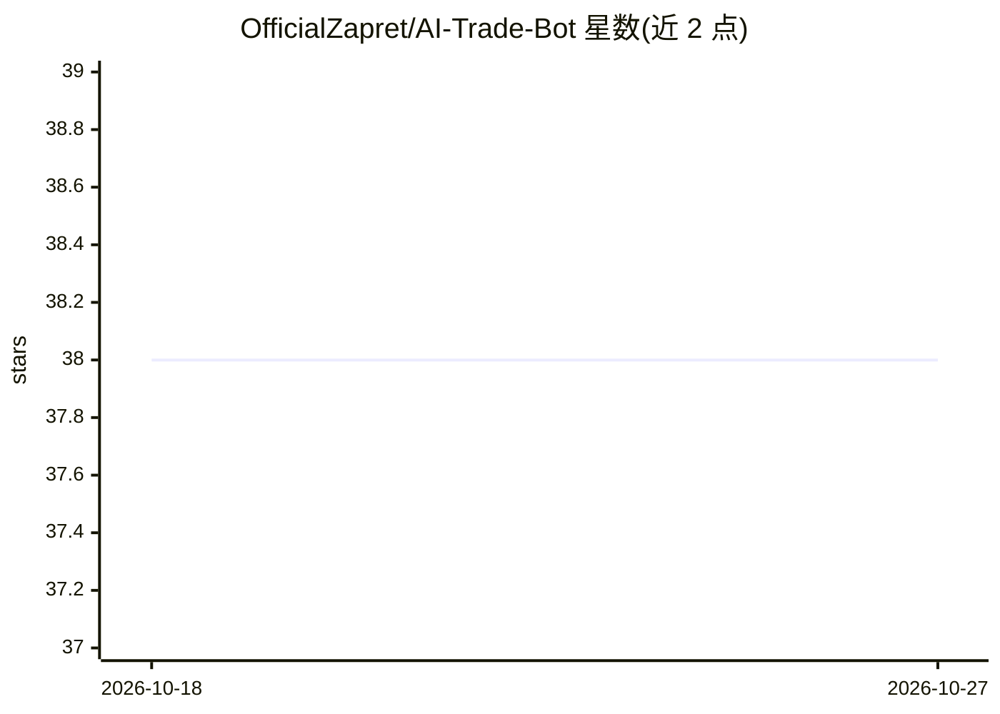

# OfficialZapret/AI-Trade-Bot

⭐ 38 · 推送 2026-07-21 · [GitHub](https://github.com/OfficialZapret/AI-Trade-Bot) · 个人维护

**浏览器端 AI 驱动的 DEX 链上自动交易机器人**

自包含的 React 应用，结合 AI 市场分析与链上直接执行：不依赖中心化交易所 API，通过智能合约与 DEX 路由连接区块链，分析价格、成交量与链上数据生成交易信号并自主签名执行。集成 MetaMask/WalletConnect 钱包，提供实时仪表盘、可配置策略、回测模式与交易提醒。以单一便携可执行文件分发，面向 Windows 10/11（64 位），首次启动后在应用内设置链、DEX、交易对与风控参数。README 多处保留模板占位符，实际技术栈（AI 模型、具体链/DEX）未明确。

## 筛选速览

| 维度 | 判定 | 备注 |
|---|---|---|
| AI 角色 | `ai-native` | 本体是模型或模型工具 |
| 许可风险 | `permissive` | — |
| 部署形态 | `None` |  |
| 模型依赖 | — | README 未给出锁定关系 |
| 硬件要求 | — | 无带数字的原话,不猜 |
| 安装摩擦 | `low` | 无编译、无系统依赖或容器化 |
| 成熟度 | — | 结构信号不足 |

## 能力要点

- AI 决策引擎分析价格、成交量与链上数据生成交易信号
- 通过智能合约与 DEX 路由直接链上执行，无需交易所 API
- MetaMask/WalletConnect 钱包签名交易
- 历史数据回测模式与实时 PnL 仪表盘

## 适用场景

- 我想在 DEX 上跑一个自动交易机器人而不把 API key 交给中心化交易所
- 在策略上线前先用历史数据回测
- 通过仪表盘实时查看链上交易组合与盈亏

## 场景标签

`金融量化` · 领域:学习与行业

## 证据(README 行号)

> L23: **AI Trader Bot** is a self-contained React application that combines AI-driven market analysis with direct on-chai
> L34: - 🧠 **AI-driven decision engine** — analyzes price action, volume, and on-chain data to generate trading signals

## 星数曲线

2026-10-18 38 → 2026-10-27 38（+0）

---
*卡片 v1 · prompt 1.4 · 生成 2026-10-25 · 置信度 mid · 依据 README sha `cd985644c19b` · [字段定义](../../DATASET.md)*
