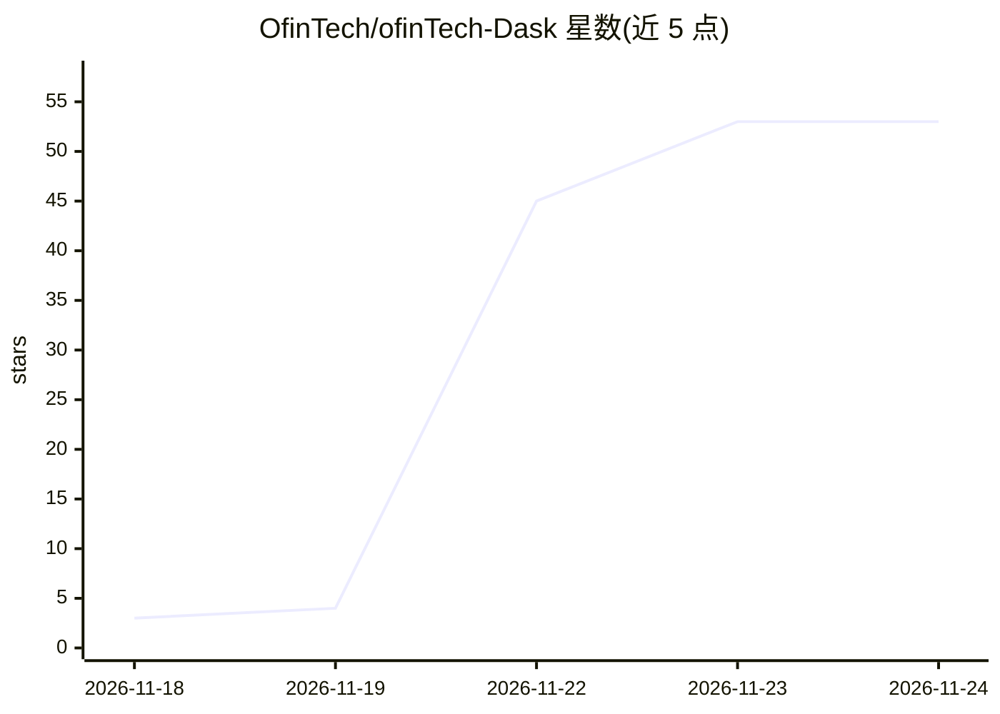

# OfinTech/ofinTech-Dask

⭐ 53 · Python · Apache-2.0 · 推送 2026-11-22 · [GitHub](https://github.com/OfinTech/ofinTech-Dask) · [官网](https://ofintech.ai/) · 组织维护

**面向财务/会计团队的 AI 工作台，每个数字可溯源**

开源桌面应用（另含可选 Team Server），读取总账、电子表格、文档与收件箱，用代码执行算术，按用户自有 Excel/Word 模板填充内容并为每个数字标注来源。助手以对话形式给出表格与 KPI，含 figure check、人工审批、记忆提案机制。支持多模型接入（云端自备 key 或本地模型）、15 个内置财务技能、35 个 KPI、预测、成本中心与月末结账流程。提供英文、阿拉伯语、西班牙语、法语界面。

## 筛选速览

| 维度 | 判定 | 备注 |
|---|---|---|
| AI 角色 | `ai-native` | 本体是模型或模型工具 |
| 许可风险 | `permissive` | Apache-2.0 |
| 部署形态 | `desktop` | 安装包/桌面程序 |
| 模型依赖 | local-ok | 支持本地模型 |
| 硬件要求 | — | 无带数字的原话,不猜 |
| 安装摩擦 | `low` | 无编译、无系统依赖或容器化 |
| 成熟度 | — | 结构信号不足 |

## 能力要点

- 每个数字可下钻至账簿分录与来源
- 自带 OpenAI/Anthropic/Gemini/DeepSeek 等多模型接入与 Ollama/LM Studio 本地模型
- 内置 OCR 的统一搜索与证据链接工作簿
- 发送与变更前需人工审批，记忆条目需人确认

## 适用场景

- 从总账生成经营概览、报表与 35 项财务 KPI
- 让助手填充公司自有 Excel/Word 模板并保留公式
- 月末结账与银行对账的人工审批流程
- 按成本中心跟踪项目预算与现金消耗

## 场景标签

`OCR` · 领域:感知与多模态

## 证据(README 行号)

> L5:  An open-source AI workspace for finance and accounting teams, in which every figure is traced to its source.
> L42: |**Any model**|Bring your own key: OpenAI, Anthropic, Google Gemini, DeepSeek, Mistral, Groq, OpenRouter, xAI, Toge

## 星数曲线

2026-11-18 3 → 2026-11-24 53（+50）

---
*卡片 v1 · prompt 1.4 · 生成 2026-11-21 · 置信度 mid · 依据 README sha `8a5a10e1c6d1` · [字段定义](../../DATASET.md)*
