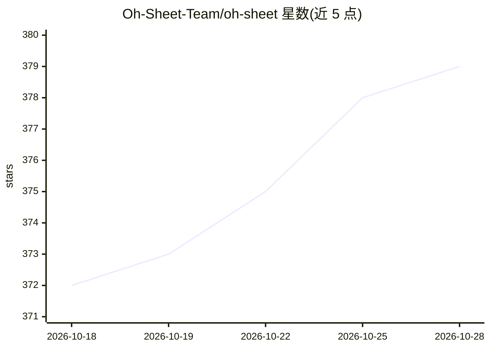

# Oh-Sheet-Team/oh-sheet

⭐ 381 · Python · MIT · 推送 2026-05-18 · [GitHub](https://github.com/Oh-Sheet-Team/oh-sheet) · 组织维护

**把任意歌曲转成可弹钢琴谱的 AI 管线应用**

输入 YouTube 链接、音频或 MIDI 文件，经下载、Basic Pitch 转录、双手钢琴编排、人性化处理与 LilyPond 制谱六阶段，输出 PDF 乐谱、MusicXML 与可播放 MIDI。后端 Python 3.10+/FastAPI，前端 Flutter 3.19+（Web 与移动端），提供 REST API、WebSocket 进度流与逐阶段无状态 worker 端点。制谱默认本地 music21+LilyPond，缺失时回落到闭源的 oh-sheet-ml-pipeline HTTP 服务（自托管可不依赖）。需 ffmpeg，Docker Compose 部署，附带确定性离线转录评测框架。

## 筛选速览

| 维度 | 判定 | 备注 |
|---|---|---|
| AI 角色 | `ai-native` | 本体是模型或模型工具 |
| 许可风险 | `permissive` | MIT |
| 部署形态 | `self-host` | docker 或自建部署 |
| 模型依赖 | — | README 未给出锁定关系 |
| 硬件要求 | — | 无带数字的原话,不猜 |
| 安装摩擦 | `low` | 无编译、无系统依赖或容器化 |
| 成熟度 | — | 结构信号不足 |

## 能力要点

- Basic Pitch 音符转录 + 可选 Demucs 分离音轨
- 双手钢琴编排（旋律右手、低音与和声左手）
- 默认本地 music21+LilyPond 制谱，可回落 HTTP 制谱服务
- 确定性离线评测：mir_eval P/R/F1，重跑结果字节一致

## 适用场景

- 粘贴 YouTube 链接生成可弹的钢琴谱
- 上传自己录制的音频或 MIDI 生成 PDF/MusicXML 乐谱
- 通过 API 把制谱能力集成到协作音乐学习平台

## 场景标签

 · 领域:音乐/AI 应用

## 证据(README 行号)

> L5:  Turn any song into playable piano sheet music with AI.
> L22: - **AI transcription** — Spotify's Basic Pitch detects notes from audio; optional Demucs stem separation isolates i

## 星数曲线

2026-10-18 372 → 2026-10-28 379（+7）

---
*卡片 v1 · prompt 1.4 · 生成 2026-10-21 · 置信度 high · 依据 README sha `e7736abe39e2` · [字段定义](../../DATASET.md)*
