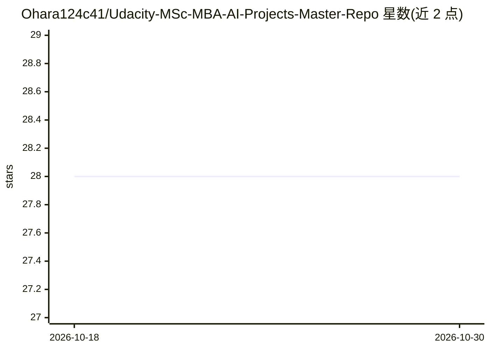

# Ohara124c41/Udacity-MSc-MBA-AI-Projects-Master-Repo

⭐ 28 · MIT · 推送 2026-08-21 · [GitHub](https://github.com/Ohara124c41/Udacity-MSc-MBA-AI-Projects-Master-Repo) · [官网](https://www.udacity.com/masters-artificial-intelligence) · 个人维护

**Udacity AI 硕士/MBA 学程项目作品集仓库（113 个项目）**

个人学习作品集：收录作者 2017–2026 年在 Udacity 五个学院、37 个 Nanodegree 项目中的 113 个项目解答，覆盖 AI 工程、自主系统、商业、数据科学与软件开发。内容包含机器人 SLAM 与状态估计、深度/强化学习、多智能体与 RAG 系统、AI 治理、数据湖与商业智能等。每个条目列出高层目标与所用技术栈，按学院分组、新项目置顶；仓库以索引形式组织，不提供统一安装运行入口。

## 筛选速览

| 维度 | 判定 | 备注 |
|---|---|---|
| AI 角色 | `ai-knowledge` | 知识聚合/清单类 |
| 许可风险 | `permissive` | MIT |
| 部署形态 | `None` |  |
| 模型依赖 | — | README 未给出锁定关系 |
| 硬件要求 | — | 无带数字的原话,不猜 |
| 安装摩擦 | `medium` | 含编译或系统依赖之一 |
| 成熟度 | — | 结构信号不足 |

## 能力要点

- 113 个项目横跨 5 个学院、37 个 Nanodegree 项目
- 含 Claude Agent SDK 多智能体代码评审、EU AI Act 治理评估、ROS 自主机器人等项目
- 每条目记录高层目标与所用技术栈，按学院分组
- 技术栈覆盖 C++/Python/MATLAB/C#/SQL 等多语言

## 适用场景

- 查看 Udacity AI 相关学程的项目内容与难度范围
- 参考各领域项目（机器人、RAG、AI 治理）的技术选型实现
- 了解个人技能成长轨迹的编目方式

## 场景标签

`精选清单` · 领域:学习与行业

## 证据(README 行号)

> L1: # Udacity Projects Master Repo
> L3: **113 projects across five schools** - Artificial Intelligence (53), Autonomous Systems (20), Business (20), Data Sc

## 星数曲线

2026-10-18 28 → 2026-10-30 28（+0）

---
*卡片 v1 · prompt 1.4 · 生成 2026-10-26 · 置信度 high · 依据 README sha `56d4e09fb185` · [字段定义](../../DATASET.md)*
