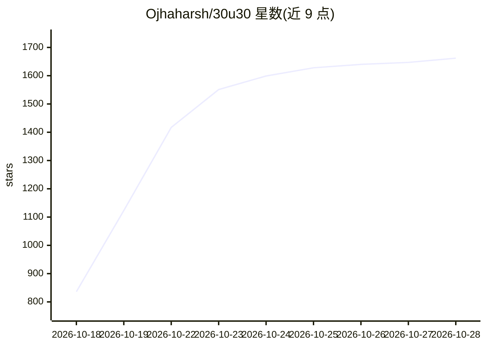

# Ojhaharsh/30u30

⭐ 1,662 · Python · NOASSERTION · 推送 2026-02-19 · [GitHub](https://github.com/Ojhaharsh/30u30) · [官网](https://ojhaharsh.github.io/30u30/) · 个人维护

**30 天精读 Ilya 推荐的 30 篇 AI 奠基论文的学习指南**

开源学习指南，按每天一篇的节奏覆盖 Ilya Sutskever 推荐的 30 篇 AI 奠基论文，从 RNN、LSTM 到 Transformer、GNN、PPO 与 RLHF。每篇配套从零实现（NumPy/PyTorch）、深度解析 README、ELI5 笔记、可视化、5 道带解答的练习、Jupyter notebook 与 CPU 可运行的快速启动脚本。全部 6 个单元已完结，面向转行 AI 者、学生与自学者，免费开放（CC BY-NC-ND 4.0），要求 Python 3.8+。

## 筛选速览

| 维度 | 判定 | 备注 |
|---|---|---|
| AI 角色 | `ai-knowledge` | 知识聚合/清单类 |
| 许可风险 | `none` | NOASSERTION |
| 部署形态 | `None` |  |
| 模型依赖 | — | README 未给出锁定关系 |
| 硬件要求 | — | 无带数字的原话,不猜 |
| 安装摩擦 | `low` | 无编译、无系统依赖或容器化 |
| 成熟度 | — | 结构信号不足 |

## 能力要点

- 30 篇论文各配从零实现与带解答的 5 道练习
- 覆盖 RNN/LSTM/Transformer/GNN/PPO/RLHF 等主题的 6 个单元
- 代码为 CPU 友好，含交互式 Jupyter notebook 与可视化

## 适用场景

- 按 30 天计划系统学习深度学习奠基论文
- 通过从零实现理解 Transformer、PPO、RLHF 等核心算法
- 转行 AI 或自学时用作结构化路线图

## 场景标签

`教程课程` · 领域:学习与行业

## 证据(README 行号)

> L12: **30u30 is an open-source study guide that takes you through the 30 foundational AI papers recommended by Ilya Suts
> L218: Each paper gets the full treatment:

## 星数曲线

2026-10-18 836 → 2026-10-28 1,662（+826）

---
*卡片 v1 · prompt 1.4 · 生成 2026-10-21 · 置信度 high · 依据 README sha `ecbb090db210` · [字段定义](../../DATASET.md)*
