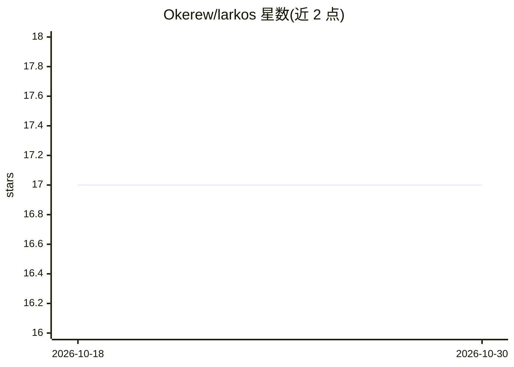

# Okerew/larkos

⭐ 17 · C · Apache-2.0 · 推送 2026-10-03 · [GitHub](https://github.com/Okerew/larkos) · 个人维护

**受大脑启发的去中心化神经网络架构的 C 语言实现**

Larkos（Lattice-Associated Recursive Knowledge Organization System）是一个用 C 实现的替代性神经网络架构：神经元去中心化、分层并以类 3D 结构连接，除状态与权重外可随时间自我改变。组件包括层级记忆系统（短期/中期/长期）、反思与元认知、自我识别、情绪/情感、想象、道德指南、目标、安全验证等子系统。面向想以框架方式取用其函数的实验性开发者；需自行用 gcc/clang 编译，可选生成 Go 嵌入向量，支持 CUDA 与 macOS Metal 版本，推荐经 Docker 构建。

## 筛选速览

| 维度 | 判定 | 备注 |
|---|---|---|
| AI 角色 | `ai-native` | 本体是模型或模型工具 |
| 许可风险 | `permissive` | Apache-2.0 |
| 部署形态 | `None` |  |
| 模型依赖 | — | README 未给出锁定关系 |
| 硬件要求 | — | 无带数字的原话,不猜 |
| 安装摩擦 | `high` | 编译与系统依赖俱全 |
| 成熟度 | — | 结构信号不足 |

## 能力要点

- 神经元分层、类 3D 连接的去中心化架构，随时间自我改变
- 短期/中期/长期层级记忆系统与遗忘衰减机制
- 反思、元认知、自我识别、情绪、想象、道德指南等十多个子系统
- 提供 C 版（ctypes 调用）、CUDA 版与 macOS Metal 版

## 适用场景

- 实验替代主流神经网络的新架构并观察其行为
- 以框架方式取用其中的记忆管理或元认知模块
- 在本地 CPU/GPU/Metal 环境编译运行该神经网络

## 场景标签

 · 领域:机器学习/认知架构

## 证据(README 行号)

> L7: This documentation provides a comprehensive guide to the Lattice-Associated Recursive Knowledge Organization System 
> L8: The goal of this architecture is to present an alternative to modern neural models, which are often complex and reso

## 星数曲线

2026-10-18 17 → 2026-10-30 17（+0）

---
*卡片 v1 · prompt 1.4 · 生成 2026-10-30 · 置信度 high · 依据 README sha `c2661e0d35c1` · [字段定义](../../DATASET.md)*
