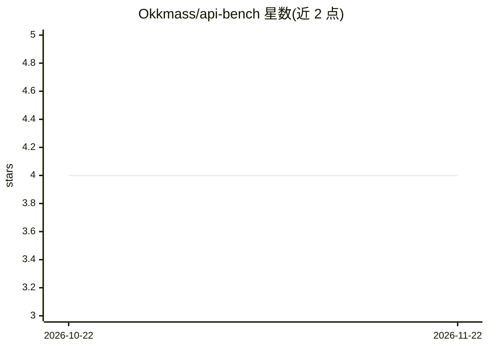

# Okkmass/api-bench

⭐ 4 · Python · MIT · 推送 2026-11-01 · [GitHub](https://github.com/Okkmass/api-bench) · [官网](https://www.okkmax.com/tools/api-speed) · 个人维护 · 中文 README

**测 AI API 网关首字延迟、缓存命中与滚动缓存的基准脚本**

两个单文件 Python 脚本，分别针对 Claude /v1/messages 与 OpenAI /v1/responses 协议的网关进行基准测试：提供 report（一页自包含 HTML 报告）、bench（并发/限速压测）、cache（缓存命中率）、roll（滚动缓存增长）四种模式，输出 TTFT、TPOT、ITL、吞吐及 p50/p90/p99 指标。纯标准库实现，无需安装依赖，密钥走环境变量。压测会发送真实请求并消耗额度。

## 筛选速览

| 维度 | 判定 | 备注 |
|---|---|---|
| AI 角色 | `ai-ecosystem` | LLM/agent 周边工具 |
| 许可风险 | `permissive` | MIT |
| 部署形态 | `library` | 以包/库形式分发 |
| 模型依赖 | — | README 未给出锁定关系 |
| 硬件要求 | — | 无带数字的原话,不猜 |
| 安装摩擦 | `low` | 无编译、无系统依赖或容器化 |
| 成熟度 | — | 结构信号不足 |

## 能力要点

- 两个单文件脚本覆盖 Claude /v1/messages 与 OpenAI /v1/responses 协议
- 四种模式：HTML 报告、并发压测（CSV/JSON 导出）、缓存命中、滚动缓存
- 指标口径对齐 GuideLLM / LLMPerf：TTFT、TPOT、ITL、吞吐、p50/p90/p99
- 纯 Python 标准库，无需 pip install，并附带模拟上游用于试跑

## 适用场景

- 选购或自建中转网关后测量首字延迟与吞吐表现
- 验证网关的 prompt 缓存是否真实命中
- 观察长对话中缓存命中区是否随对话增长
- 用模拟上游试跑脚本或做 CI 冒烟测试

## 场景标签

`模型评测` · 领域:评测与运维

## 证据(README 行号)

> L14: 买了中转站或自建了网关，最想知道三件事：**首字够不够快、缓存到底有没有命中、长对话会不会越用越烧钱**。api-bench 用两个单文件脚本回答它们：
> L22: - 四种模式：`report`（一页自包含 HTML 报告，最常用）、`bench`（并发 / 限速压测）、`cache`（缓存命中率）、`roll`（滚动缓存）。

## 星数曲线

2026-10-22 4 → 2026-11-22 4（+0）

---
*卡片 v1 · prompt 1.4 · 生成 2026-11-21 · 置信度 mid · 依据 README sha `6ee47d1438b3` · [字段定义](../../DATASET.md)*
