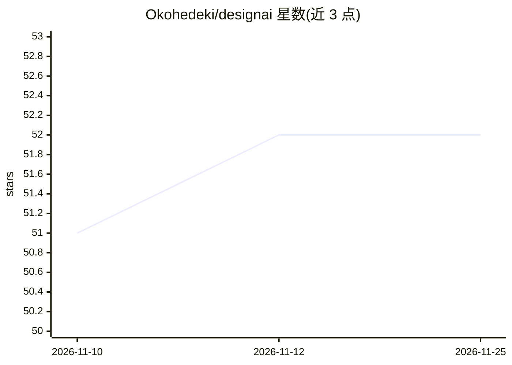

# Okohedeki/designai

⭐ 52 · Python · AGPL-3.0 · 推送 2026-11-23 · [GitHub](https://github.com/Okohedeki/designai) · [官网](https://okohedeki.github.io/designai/) · 个人维护

**从一张照片或简短 brief 生成电商创意与滚动网站的本地生成引擎**

面向商业创意的开源生成引擎：从单张产品照片或文字简报生成产品图、广告、商品列表、产品视频与滚动驱动网站。重型场景（生成影片与图像）用本地开源模型（Z-Image、Qwen-Image-Edit、LTX-2.3、Wan 2.2、SeedVR2、Blender）在自有 GPU 上运行，需 ComfyUI 与 24GB 显存的 GPU；图片视差、地图、数据、live 3D 等场景仅需 Python 与浏览器。输出为纯 HTML/CSS/JS，可任意托管。提供 studio CLI 与 MCP server，可由 Claude 等编码 agent 驱动整个工作流。默认本地模型，无需 API key。

## 筛选速览

| 维度 | 判定 | 备注 |
|---|---|---|
| AI 角色 | `ai-native` | 本体是模型或模型工具 |
| 许可风险 | `viral` | AGPL-3.0 |
| 部署形态 | `library` | 以包/库形式分发 |
| 模型依赖 | — | README 未给出锁定关系 |
| 硬件要求 | — | 无带数字的原话,不猜 |
| 安装摩擦 | `low` | 无编译、无系统依赖或容器化 |
| 成熟度 | — | 结构信号不足 |

## 能力要点

- 从一图或一 brief 生成产品图/视频/滚动网站，输出纯 HTML/CSS/JS
- 生成影片与图像走本地开源模型（ComfyUI + 24GB GPU），多数场景无需 GPU
- studio remake <url> 可将现有落地页重构为滚动网站
- MCP server 向 Claude 开放全部引擎工具

## 适用场景

- 用一张产品照快速生成商品图、广告与滚动式落地页
- 把现有落地页改造成滚动叙事网站
- 让 Claude 等编码 agent 通过 MCP 驱动整个建站工作流
- 在本地无 API key 环境下批量产出商业创意素材

## 场景标签

`图像生成` `视频生成` `工作流自动化` · 领域:效率与自动化

## 证据(README 行号)

> L3:  An open-source generation engine for commerce creative: product stills, ads, listings, product video and scroll-dri
> L39: The heavy scenes (generated film and images) are made with open models on your own GPU (Z-Image, Qwen-Image-Edit, L

## 星数曲线

2026-11-10 51 → 2026-11-25 52（+1）

---
*卡片 v1 · prompt 1.4 · 生成 2026-11-18 · 置信度 high · 依据 README sha `6bc6949310aa` · [字段定义](../../DATASET.md)*
