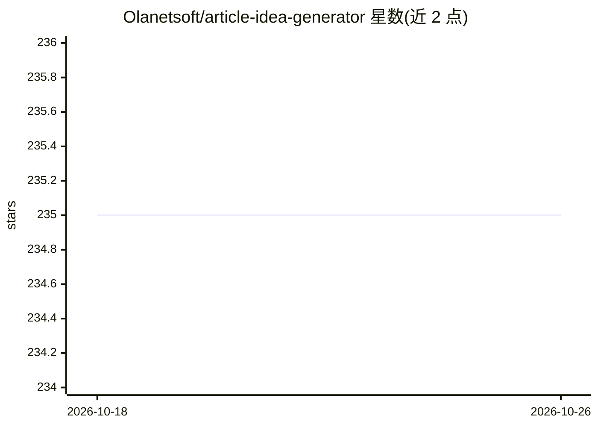

# Olanetsoft/article-idea-generator

⭐ 235 · TypeScript · 推送 2026-08-17 · [GitHub](https://github.com/Olanetsoft/article-idea-generator) · [官网](https://www.articleideagenerator.com/) · 个人维护

**输入主题生成文章标题的 Web 工具站，附多项免费在线工具**

基于 Next.js 13 的 Web 应用：核心功能为输入主题后调用 OpenAI GPT-4o-mini 生成 4 个文章标题建议，支持 SEO 与 Clickbait 模式切换、摘要生成、字符数 SEO 指示与最近搜索记录。另附免费工具集：字数统计、二维码生成（17+ 类型、批量、可选扫描统计）、PDF 签署（浏览器本地处理）、大小写转换、JSON 格式化、短链服务 aigl.ink（含登录后分析）、封面图生成与浏览器本地 AI 抠图。本地运行需 Node.js 14+ 与 OPENAI_API_KEY，可选 Supabase 支持短链分析。

## 筛选速览

| 维度 | 判定 | 备注 |
|---|---|---|
| AI 角色 | `ai-native` | 本体是模型或模型工具 |
| 许可风险 | `permissive` | — |
| 部署形态 | `library` | 以包/库形式分发 |
| 模型依赖 | — | README 未给出锁定关系 |
| 硬件要求 | — | 无带数字的原话,不猜 |
| 安装摩擦 | `low` | 无编译、无系统依赖或容器化 |
| 成熟度 | — | 结构信号不足 |

## 能力要点

- GPT-4o-mini 生成 4 个标题建议，含 SEO/Clickbait 模式与摘要生成
- 17+ 类型二维码生成，支持批量与 ZIP 下载
- PDF 签署与 AI 抠图均在浏览器本地处理，文件不上传
- 短链服务 aigl.ink，登录后提供点击与访问分析

## 适用场景

- 写作前快速获得文章标题与摘要灵感
- 一站式使用二维码、PDF 签署、封面图等在线工具
- 为文章生成社交平台封面图

## 场景标签

`AI 写作` `图像生成` `图像视频处理` · 领域:内容生成

## 证据(README 行号)

> L9: Generate article ideas using GPT-4o-mini. Enter a topic, get 4 title suggestions with optional SEO optimization.
> L182: Uses OpenAI GPT-4o-mini:

## 星数曲线

2026-10-18 235 → 2026-10-26 235（+0）

---
*卡片 v1 · prompt 1.4 · 生成 2026-10-22 · 置信度 high · 依据 README sha `7ac3ae56d663` · [字段定义](../../DATASET.md)*
