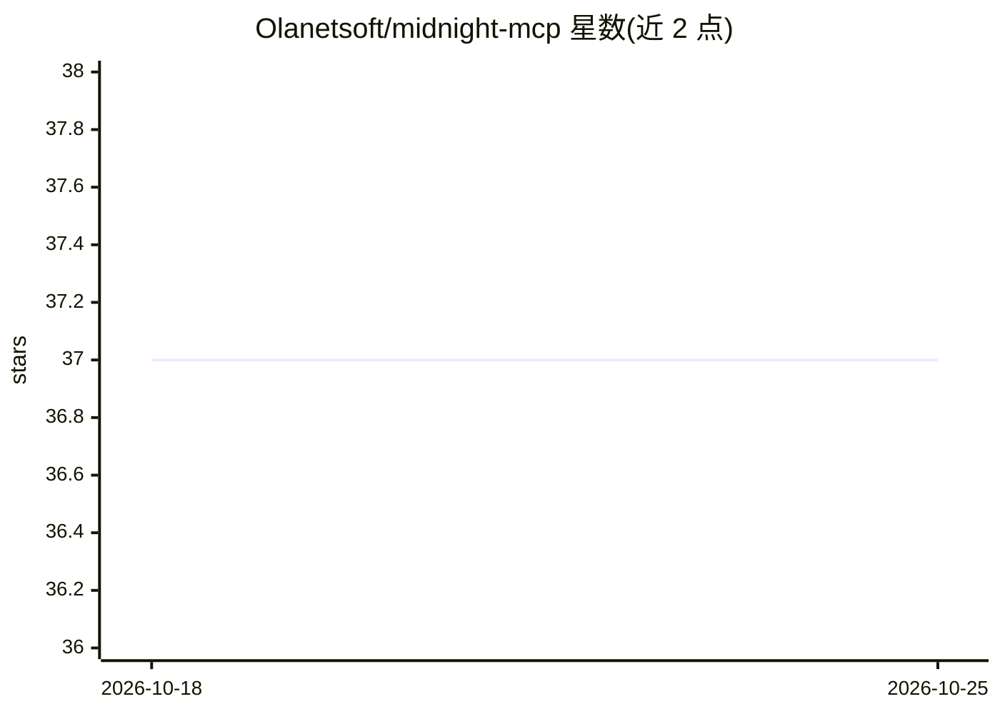

# Olanetsoft/midnight-mcp

⭐ 37 · TypeScript · MIT · 推送 2026-07-02 · [GitHub](https://github.com/Olanetsoft/midnight-mcp) · [官网](https://www.npmjs.com/package/midnight-mcp) · 个人维护

**让 AI 助手访问 Midnight 区块链的 MCP 服务器（已弃用）**

TypeScript 编写的 MCP 服务器，向 Claude Desktop、Cursor、VS Code Copilot、Windsurf 等 AI 助手提供 29 个工具：检索与获取 Midnight 文档、分析/编译 Compact 智能合约（含托管编译器与静态分析检查）、追踪版本迁移、以及需客户端 sampling 支持的 AI 生成/审查合约；索引 115+ 个 Midnight 生态仓库。无需 API key，经 npx 运行，支持 HTTP 模式与本地模式（需 ChromaDB 和 OpenAI key）。README 顶部声明项目已弃用，迁移至 Kapa MCP 与 Midnight Expert。

## 筛选速览

| 维度 | 判定 | 备注 |
|---|---|---|
| AI 角色 | `ai-ecosystem` | LLM/agent 周边工具 |
| 许可风险 | `permissive` | MIT |
| 部署形态 | `self-host` | docker 或自建部署 |
| 模型依赖 | — | README 未给出锁定关系 |
| 硬件要求 | — | 无带数字的原话,不猜 |
| 安装摩擦 | `low` | 无编译、无系统依赖或容器化 |
| 成熟度 | — | 结构信号不足 |

## 能力要点

- 29 个工具覆盖搜索、合约分析/编译、版本迁移、AI 生成等
- 真实合约编译：托管编译器，快/全两种模式，失败回退静态分析
- 索引 115+ Midnight 生态仓库，含 9 个离线参考资源与 5 个工作流提示词
- 无需 API key，npx 运行，另有 HTTP 与本地模式

## 适用场景

- 在 Claude/Cursor 等 AI 助手中搜索 Midnight 合约与文档
- 让 AI 分析、编译与审查 Compact 智能合约
- 处理 Compact 语言版本迁移与破坏性变更

## 场景标签

`语义搜索` · 领域:知识与检索

## 证据(README 行号)

> L18: MCP server that gives AI assistants access to Midnight blockchain—search contracts, analyze code, and explore docum
> L94: ### 29 Tools

## 星数曲线

2026-10-18 37 → 2026-10-25 37（+0）

---
*卡片 v1 · prompt 1.4 · 生成 2026-10-25 · 置信度 mid · 依据 README sha `51ea005c0f65` · [字段定义](../../DATASET.md)*
