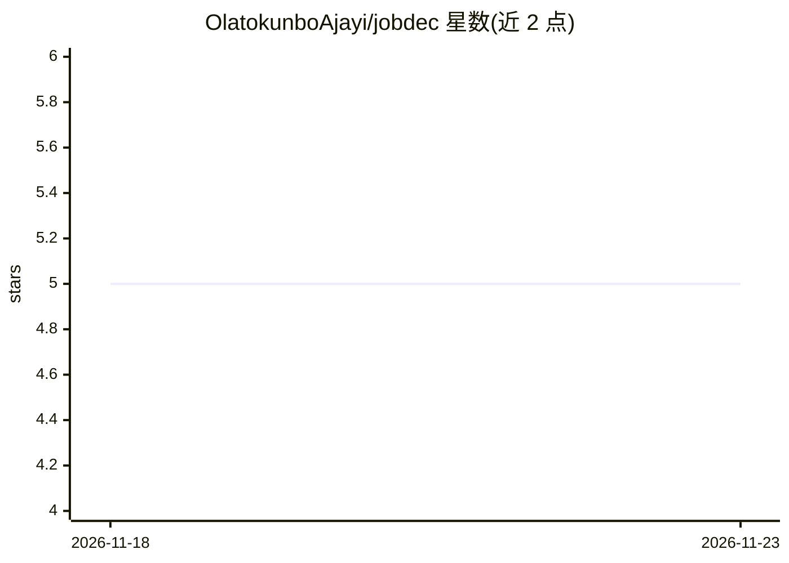

# OlatokunboAjayi/jobdec

⭐ 5 · Python · MIT · 推送 2026-11-18 · [GitHub](https://github.com/OlatokunboAjayi/jobdec) · [官网](https://olatokunboajayi.github.io) · 个人维护

**本地优先的多 Agent 求职/实习自动申请引擎**

在本地运行的自治流水线：抓取职位、用本地神经嵌入评分匹配度、通过无头 Chromium 在 Workday/Greenhouse/Taleo/iCIMS 等 ATS 表单自动填交，经 IMAP 读取 Gmail 处理注册验证与 OTP，并从表单摩擦中生成 regex 规则避免重复卡壳。默认本地规则引擎零成本运行，配置 ANTHROPIC_API_KEY 后启用 Claude 引擎并设每日预算上限。内置知识图谱与 Graph-RAG 提供引荐路径与有据回答，附 Cyberdeck TUI 与 Web 仪表盘。含每日申请上限、保护雇主名单、禁止臆造法务/人口学答案等护栏。

## 筛选速览

| 维度 | 判定 | 备注 |
|---|---|---|
| AI 角色 | `ai-native` | 本体是模型或模型工具 |
| 许可风险 | `permissive` | MIT |
| 部署形态 | `None` |  |
| 模型依赖 | locked-api |  |
| 硬件要求 | — | 无带数字的原话,不猜 |
| 安装摩擦 | `low` | 无编译、无系统依赖或容器化 |
| 成熟度 | — | 结构信号不足 |

## 能力要点

- 7 个自治 Agent：搜寻、简历定制、表单作答、账号/OTP 验证、收件分析、规则自愈、协调调度
- 双引擎：默认本地 regex+嵌入零成本，可选 Claude 引擎带每日预算上限
- networkx 知识图谱提供引荐路径查找与 Graph-RAG 证据检索
- 申请护栏：匹配分门槛、每日上限、保护雇主名单、零臆造策略

## 适用场景

- 自动化投递 Workday/Greenhouse 等 ATS 平台的实习与职位申请
- 在匹配分门槛和每日限额控制下筛选值得申请的职位
- 从 LinkedIn 人脉中计算通往目标公司的引荐路径
- 通过 TUI/Web 仪表盘实时监控投递进度与结果

## 场景标签

`多智能体` `浏览器自动化` `知识图谱` `RAG` · 领域:Agent 开发

## 证据(README 行号)

> L17: It is an autonomous agentic pipeline designed to run locally on your machine. It scans for fresh postings, evaluate
> L62: |**AI (Claude)**|`ANTHROPIC_API_KEY` set in `.env`|~$1–3 / day|Uses Claude models (Haiku for fast scouting, Sonnet 

## 星数曲线

2026-11-18 5 → 2026-11-23 5（+0）

---
*卡片 v1 · prompt 1.4 · 生成 2026-11-21 · 置信度 high · 依据 README sha `378975a98a80` · [字段定义](../../DATASET.md)*
