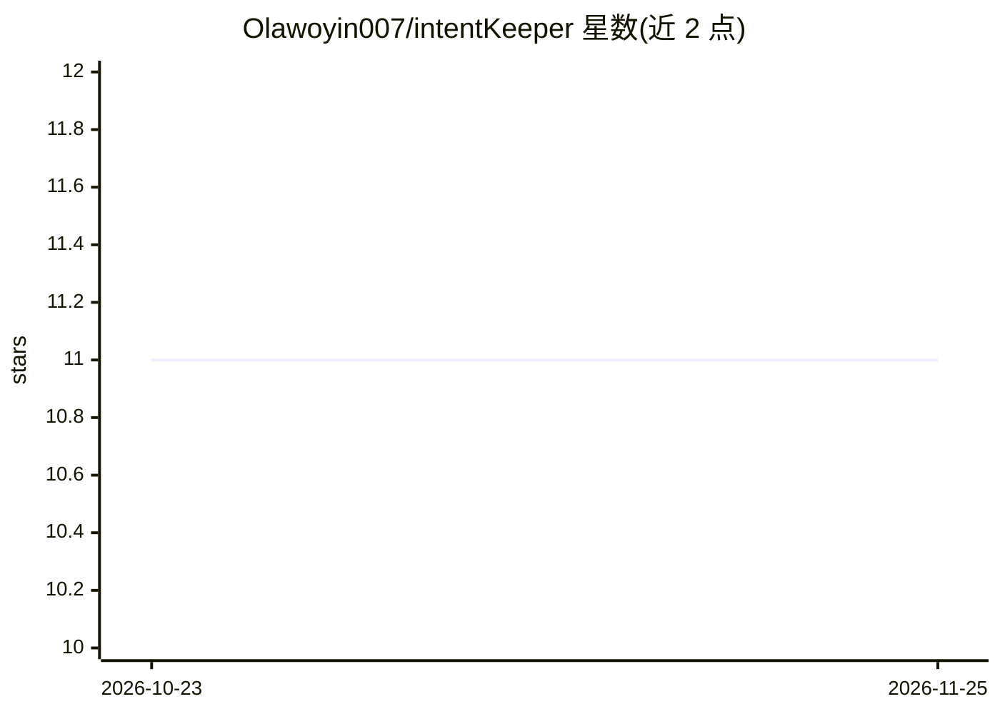

# Olawoyin007/intentKeeper

⭐ 11 · Python · MIT · 推送 2026-11-18 · [GitHub](https://github.com/Olawoyin007/intentKeeper) · 个人维护

**本地运行的浏览器扩展：标注社交媒体帖子的操纵手法**

intentKeeper 由分类服务器与浏览器扩展两部分组成：扩展读取 Twitter/X、YouTube、Reddit 上的帖子，识别 ragebait、fearmongering、hype、engagement bait、divisive framing 等框架模式并就地标注，不隐藏内容。分类通过本机 Ollama 运行的 LLM 完成，不上传数据；fail-open 机制下分类失败时内容原样通过。安装支持 Docker Compose 或 pip 源码安装，扩展在 Chrome 系浏览器加载 unpacked 目录，Firefox 需单独 npm 构建。官方评测集为 105 例，标注测得准确率上限 96%，并声明对玩笑、讽刺类误报未做测试。

## 筛选速览

| 维度 | 判定 | 备注 |
|---|---|---|
| AI 角色 | `ai-native` | 本体是模型或模型工具 |
| 许可风险 | `permissive` | MIT |
| 部署形态 | `self-host` | docker 或自建部署 |
| 模型依赖 | local-ok | 支持本地模型 |
| 硬件要求 | — | 无带数字的原话,不猜 |
| 安装摩擦 | `low` | 无编译、无系统依赖或容器化 |
| 成熟度 | `idea` | |

## 能力要点

- 识别 5 类操纵模式（ragebait/fearmongering/hype/engagement bait/divisive）并就地标注
- 分类全程经本机 Ollama 运行，无云端、无数据收集
- 提供 105 例评测集基准与各模型 VRAM/准确率/延迟对照表
- fail-open：分类失败时内容原样展示

## 适用场景

- 刷 Twitter/X、YouTube、Reddit 时识别情绪化操纵内容
- 低 VRAM 机器上用 llama3.2 做轻量本地分类
- 离线隐私环境下审核信息流内容框架

## 场景标签

 · 领域:内容审核/浏览器工具

## 证据(README 行号)

> L19: intentKeeper reads posts on Twitter/X, YouTube and Reddit and labels the ones using ragebait, fearmongering, hype, 
> L21: Classification runs on your own machine via Ollama. Nothing is sent anywhere and nothing is tracked.
> L41: **Accuracy**: up to 96% on a 105-example labeled eval set (measured 2026-07-13 with `llama3.1:8b`). The set has gro

## 星数曲线

2026-10-23 11 → 2026-11-25 11（+0）

---
*卡片 v1 · prompt 1.4 · 生成 2026-11-19 · 置信度 high · 依据 README sha `979b93bacd21` · [字段定义](../../DATASET.md)*
