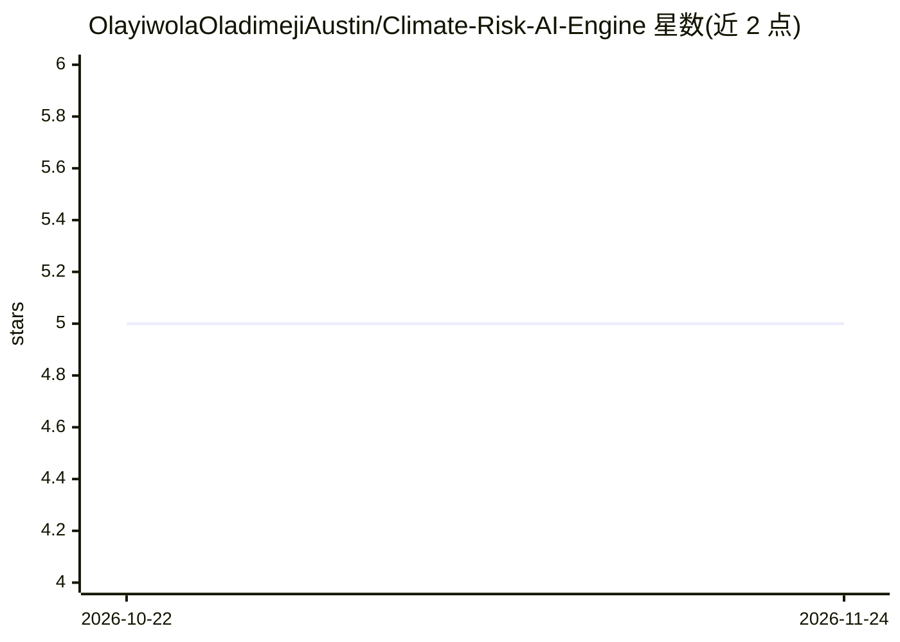

# OlayiwolaOladimejiAustin/Climate-Risk-AI-Engine

⭐ 5 · Python · 推送 2026-11-21 · [GitHub](https://github.com/OlayiwolaOladimejiAustin/Climate-Risk-AI-Engine) · 个人维护

**面向开发者/政策方的气候风险预测与土地利用建模框架**

一个机器学习框架，用于预测区域气候脆弱性并优化土地利用策略。仓库分为三部分：多源环境数据摄取与预处理（含遥感与社会经济指标）、预测建模（预测气候冲击、评估土地使用强度与适应策略）、自动化评估报告（生成风险指数供政策制定者与农业利益相关方使用）。技术栈为 Python 3.10+，配合 Scikit-Learn、GeoPandas、TensorFlow/PyTorch 等，环境管理支持 Conda/Docker。README 声明其定位为技术作品集展示，结构含样本与合成数据集模式，未给出可运行的安装命令与硬件要求。

## 筛选速览

| 维度 | 判定 | 备注 |
|---|---|---|
| AI 角色 | `ai-native` | 本体是模型或模型工具 |
| 许可风险 | `none` | — |
| 部署形态 | `None` |  |
| 模型依赖 | — | README 未给出锁定关系 |
| 硬件要求 | — | 无带数字的原话,不猜 |
| 安装摩擦 | `low` | 无编译、无系统依赖或容器化 |
| 成熟度 | — | 结构信号不足 |

## 能力要点

- 三模块架构：数据摄取、预测建模、评估报告
- 预测气候冲击并生成风险指数与可执行洞察
- 支持多源环境数据、遥感输入与社会经济指标
- 环境管理提供 Conda/Docker 选项

## 适用场景

- 评估农业区域的气候脆弱性与适应策略
- 为政策制定者生成区域风险指数报告
- 整合遥感与社会经济数据做气候冲击预测

## 场景标签

 · 领域:气候科技/环境可持续

## 证据(README 行号)

> L15: 2. **Predictive Modeling (`/models`):** Machine learning models designed to forecast climate shocks, assess land-us
> L16: 3. **Evaluation & Reporting (`/scripts`):** Automated analysis scripts that generate risk indices and actionable in

## 星数曲线

2026-10-22 5 → 2026-11-24 5（+0）

---
*卡片 v1 · prompt 1.4 · 生成 2026-11-21 · 置信度 mid · 依据 README sha `d6ef46541bc8` · [字段定义](../../DATASET.md)*
