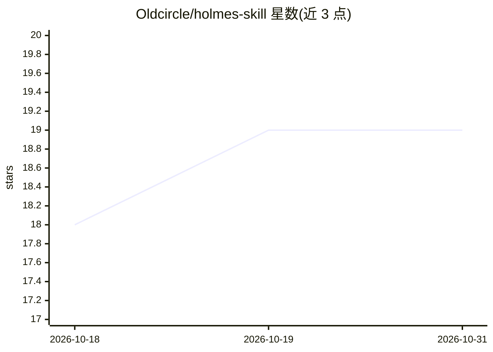

# Oldcircle/holmes-skill

⭐ 19 · TypeScript · MIT · 推送 2026-09-19 · [GitHub](https://github.com/Oldcircle/holmes-skill) · 个人维护 · 中文 README

**让 agent 像福尔摩斯一样读照片推理的技能包**

一个标准 Agent Skill（SKILL.md + 痕迹参考库），指导有视觉能力的模型对照片做两阶段推理：先列出可核实的观察并封存清单，再基于观察编号做引用证据的推理，每条结论附置信度与替代解释，用户逐条评分为命中/半中/失误，最终输出命中率与虚假观察率。附带 98 条双语痕迹库（痕迹→可能成因及权重），限定只记录习惯痕迹，不涉及面容/族群等特征。另有纯静态 Web 版，自带 API key 调用各家多模态模型，并通过两次分离调用与图像核验（方向/主色比对）防止模型未真正看图。

## 筛选速览

| 维度 | 判定 | 备注 |
|---|---|---|
| AI 角色 | `ai-native` | 本体是模型或模型工具 |
| 许可风险 | `permissive` | MIT |
| 部署形态 | `library` | 以包/库形式分发 |
| 模型依赖 | — | README 未给出锁定关系 |
| 硬件要求 | — | 无带数字的原话,不猜 |
| 安装摩擦 | `low` | 无编译、无系统依赖或容器化 |
| 成熟度 | — | 结构信号不足 |

## 能力要点

- 先封存观察清单再推理，结论必须引用观察编号
- 用户逐条评分，输出命中率与虚假观察率两个指标
- 98 条双语痕迹库，映射痕迹到可能成因及权重
- Web 版两次分离调用并用方向/主色比对核验模型确实看了图

## 适用场景

- 给我的编程 agent 装上，让它像福尔摩斯一样分析我的桌面或房间照片
- 测试多模态模型的观察-推理能力并获得可量化评分
- 在浏览器里用自带 key 跑完整个观察-推理-评分流程

## 场景标签

`多模态` `提示工程` · 领域:Agent 开发

## 证据(README 行号)

> L3: **An agent skill that reads a photo the way Sherlock Holmes reads a stranger, and shows its work.**
> L41: - **It looks first and thinks second.** Everything it can see goes on a numbered list, and the list is sealed befor
> L46: - **No API key, no server.** The skill is one Markdown file and a trace library. The model your agent already uses 

## 星数曲线

2026-10-18 18 → 2026-10-31 19（+1）

---
*卡片 v1 · prompt 1.4 · 生成 2026-10-28 · 置信度 high · 依据 README sha `6e9882e77814` · [字段定义](../../DATASET.md)*
