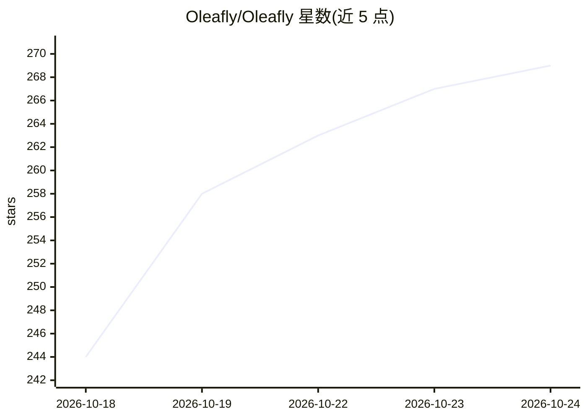

# Oleafly/Oleafly

⭐ 270 · TypeScript · AGPL-3.0 · 推送 2026-10-24 · [GitHub](https://github.com/Oleafly/Oleafly) · [官网](https://oleafly.com) · 组织维护

**面向科研写作的 LaTeX/Typst/Markdown 实时协作编辑器，AI 可选**

跨平台桌面编辑器，支持 LaTeX、Typst 与 Markdown，内置 Tectonic/Typst/Pandoc 编译，源码、PDF、引用、图表与 Git 历史集成于同一界面。面向科研作者与实验室：共享光标实时协作、评论、云同步、Zotero 引用、1700+ 模板、Preflight 投稿前检查。AI 部分为可选：Claude Code、Codex 等 14 种 agent 可在项目内工作，也可连接托管模型或本地 Ollama，改动以 diff 呈现可撤销。服务器端为单一 Rust 二进制，用 SQLite，支持 GitHub/OpenID Connect 登录，自称 beta。

## 筛选速览

| 维度 | 判定 | 备注 |
|---|---|---|
| AI 角色 | `ai-enhanced` | 去掉 AI 部分产品仍成立 |
| 许可风险 | `viral` | AGPL-3.0 |
| 部署形态 | `self-host` | docker 或自建部署 |
| 模型依赖 | local-ok | 支持本地模型 |
| 硬件要求 | — | 无带数字的原话,不猜 |
| 安装摩擦 | `low` | 无编译、无系统依赖或容器化 |
| 成熟度 | `idea` | |

## 能力要点

- 实时协作：共享光标、评论、离线合并与权限管理
- 14 种 AI agent 可在项目内工作，AI 为可选且每步改动以 diff 呈现
- 内置 Tectonic/Typst/Pandoc 编译，PDF-源码互跳与 SyncTeX
- 服务器为单一 Rust 二进制+SQLite，一条命令自托管，支持 S3 兼容存储

## 适用场景

- 与共同作者实时协作撰写 LaTeX/Typst 论文
- 实验室或院系自托管协作服务器并接入学校单点登录
- 让 AI agent 在项目副本中做文献综述或修订，再挑选保留的文件
- 从 Overleaf 等在线 LaTeX 账号导入项目并双向同步

## 场景标签

`科研工具` `AI 助手` `AI 写作` · 领域:对话与助手

## 证据(README 行号)

> L39: - Claude Code, Codex and 12 more agents work inside your project, or connect any model, local ones included. AI is 
> L123: AI is optional. The editor, compiler, PDF, citations, proofreading and checks all work with it off.

## 星数曲线

2026-10-18 244 → 2026-10-24 269（+25）

---
*卡片 v1 · prompt 1.4 · 生成 2026-10-22 · 置信度 mid · 依据 README sha `bfcf924183d7` · [字段定义](../../DATASET.md)*
