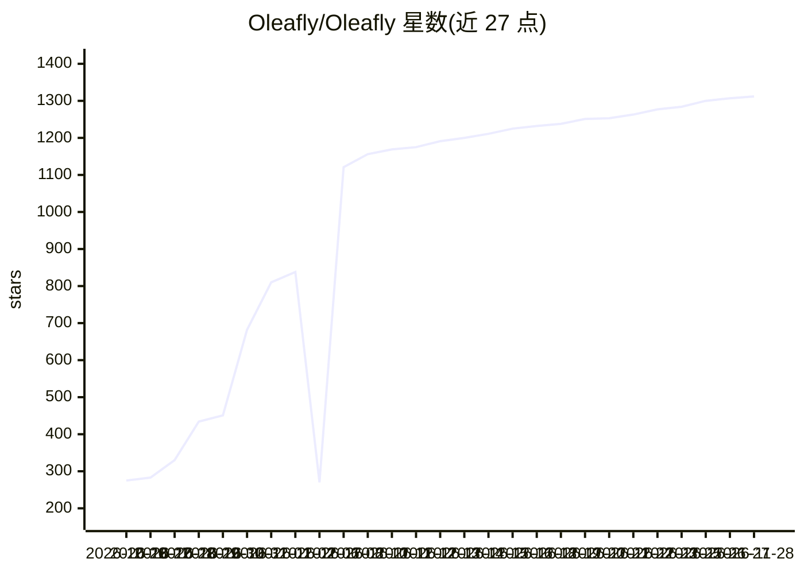

# Oleafly/Oleafly

⭐ 1,312 · TypeScript · AGPL-3.0 · 推送 2026-11-27 · [GitHub](https://github.com/Oleafly/Oleafly) · [官网](https://oleafly.com) · 组织维护 · 中文 README

**科研写作的开源 LaTeX/Typst 协作编辑器，内置 AI agent**

面向科研写作的开源工作区，含桌面 IDE（macOS/Windows/Linux）、实验室自托管的实时协作服务器、CLI 与浏览器视图。编译 LaTeX、Typst 与 Markdown，项目以 Git 仓库管理并自动存档检查点；提供 1,700+ 模板、Zotero 引用、多文献库检索与 Preflight 检查。AI 部分以 agent 目录形式接入 Claude Code、Codex 等 15 个 CLI agent，每次编辑以 diff 呈现供审阅；实验性 Research Tasks 在隔离 worktree 中后台执行文献综述或修订。AGPL v3 许可。

## 筛选速览

| 维度 | 判定 | 备注 |
|---|---|---|
| AI 角色 | `ai-enhanced` | 去掉 AI 部分产品仍成立 |
| 许可风险 | `viral` | AGPL-3.0 |
| 部署形态 | `self-host` | docker 或自建部署 |
| 模型依赖 | local-ok | 支持本地模型 |
| 硬件要求 | — | 无带数字的原话,不猜 |
| 安装摩擦 | `low` | 无编译、无系统依赖或容器化 |
| 成熟度 | `idea` | |

## 能力要点

- 接入 Claude Code、Codex、Gemini CLI 等 15 个 agent，每次编辑以可撤销的 diff 呈现
- 自托管协作服务器：共享光标、评论、聊天、tracked changes 与离线合并
- 内置 Tectonic、Typst、Pandoc 编译，每项目为 Git 仓库并自动检查点
- 1,700+ 模板、Zotero 引用、arXiv/Semantic Scholar/PubMed 等检索与 Preflight 检查

## 适用场景

- 实验室自建 LaTeX 协作服务器替代在线服务
- 用 AI agent 在项目中执行文献综述或修订并通过 diff 审阅
- 从 Overleaf 导入项目并保持双向 Git 同步
- 学术论文、学位论文、幻灯片与海报的模板化写作

## 场景标签

`科研工具` · 领域:学习与行业

## 证据(README 行号)

> L17: Oleafly is a free, open-source workspace for scientific research writing. It includes a desktop agentic development
> L46: - Claude Code, Codex and 13 more agents work inside your project, or connect any model, local ones included. AI is 

## 星数曲线

2026-10-26 275 → 2026-11-28 1,312（+1,037）

---
*卡片 v1 · prompt 1.4 · 生成 2026-11-23 · 置信度 mid · 依据 README sha `7372c1d4d1f5` · [字段定义](../../DATASET.md)*
