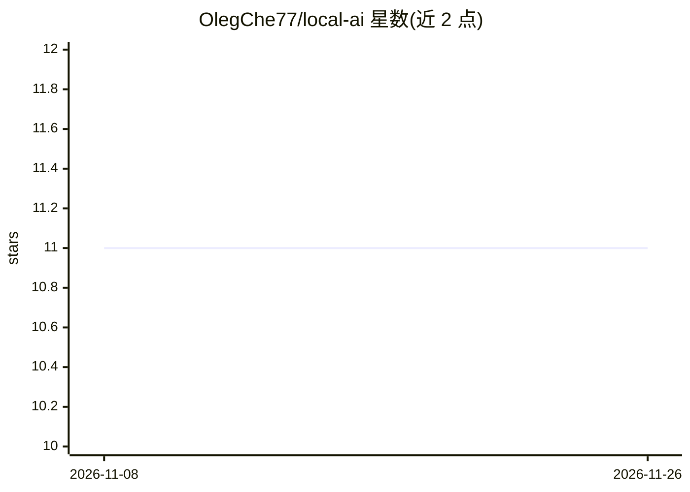

# OlegChe77/local-ai

⭐ 11 · JavaScript · MIT · 推送 2026-11-03 · [GitHub](https://github.com/OlegChe77/local-ai) · 个人维护

**Windows 一键安装本地 AI 聊天：按硬件选模型并装 Ollama**

面向 Windows 10/11 的本地聊天程序，打包为单个 LocalAI.exe，无需安装 Python。启动后检测显卡、显存、内存与磁盘空间，从 34 个模型的目录中筛选可装入显存的模型（无显卡时给出 CPU 轻量模型），随后下载并静默安装 Ollama（校验数字签名、免管理员权限）再下载模型。聊天支持流式输出、Markdown、推理过程展示、文本与图片附件；模型安装/切换均需用户确认，卸载可一键清除程序与模型。聊天通过本机 Ollama（127.0.0.1）完成，无需联网与账号。

## 筛选速览

| 维度 | 判定 | 备注 |
|---|---|---|
| AI 角色 | `ai-ecosystem` | LLM/agent 周边工具 |
| 许可风险 | `permissive` | MIT |
| 部署形态 | `desktop` | 安装包/桌面程序 |
| 模型依赖 | local-ok | 支持本地模型 |
| 硬件要求 | — | 无带数字的原话,不猜 |
| 安装摩擦 | `low` | 无编译、无系统依赖或容器化 |
| 成熟度 | — | 结构信号不足 |

## 能力要点

- 按显卡/显存/内存自动筛选模型，目录含 34 个模型（Qwen3、Gemma 3、Llama 3.x、Mistral、Phi-4、DeepSeek-R1 等）
- 自动下载并静默安装 Ollama，校验数字签名，支持断点续传
- 流式聊天：Markdown、代码块、推理模式、图片/文本附件、token/s 速度显示
- 模型/程序一键卸载，界面支持俄英双语与深浅主题

## 适用场景

- 在无外网环境下与本地大模型对话
- 不想手动配置 Ollama 与模型的 Windows 用户
- 根据显卡配置快速找到能跑的模型

## 场景标签

`聊天机器人` `AI 助手` · 领域:对话与助手

## 证据(README 行号)

> L13: Свой ИИ-чат на вашем компьютере в один клик. Программа сама смотрит, какая у вас видеокарта, сколько памяти и места
> L53: - Чат работает через Ollama на этом же компьютере (`127.0.0.1`), наружу ничего не уходит.

## 星数曲线

2026-11-08 11 → 2026-11-26 11（+0）

---
*卡片 v1 · prompt 1.4 · 生成 2026-11-19 · 置信度 high · 依据 README sha `228b5759107d` · [字段定义](../../DATASET.md)*
