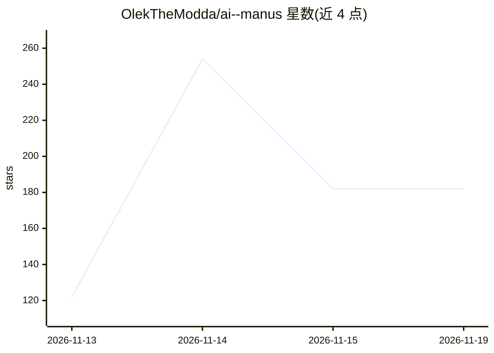

# OlekTheModda/ai--manus

⭐ 182 · Apache-2.0 · 推送 2026-11-15 · [GitHub](https://github.com/OlekTheModda/ai--manus) · 个人维护

**面向日常任务的自主 AI Agent：代用户运行代码并控制浏览器**

README 描述的 Manus 是一个自主 AI agent，定位为家庭、学习与轻量办公场景的个人助手：可自行编写并执行脚本、控制浏览器（导航网页、填写表单、采集信息），串联多步骤任务，并在会话间复用工作流模式。README 同时给出自身运行所需的硬件兼容表（双核 CPU、4GB 内存起步，推荐 8GB）。需注意：全文为宣传式描述，未给出任何技术实现细节、模型接入方式或可验证的安装命令，仅有一个下载入口与促销码。

## 筛选速览

| 维度 | 判定 | 备注 |
|---|---|---|
| AI 角色 | `ai-native` | 本体是模型或模型工具 |
| 许可风险 | `permissive` | Apache-2.0 |
| 部署形态 | `None` |  |
| 模型依赖 | — | README 未给出锁定关系 |
| 硬件要求 | — | 无带数字的原话,不猜 |
| 安装摩擦 | `low` | 无编译、无系统依赖或容器化 |
| 成熟度 | — | 结构信号不足 |

## 能力要点

- 自主编写并执行代码完成任务
- 浏览器控制：导航、填表、采集信息
- 代码与浏览器动作可在同一任务流中衔接
- 给出最低/推荐硬件兼容表（双核 CPU、4GB RAM）

## 适用场景

- 让 agent 代为浏览多个网页并汇总信息
- 自动运行小脚本与重复性代码任务
- 学习与家庭项目中的后台个人助手

## 场景标签

`浏览器自动化` `AI 助手` `编码 Agent` · 领域:效率与自动化

## 证据(README 行号)

> L10: - **Autonomous Code Execution:** Manus AI agent runs code on its own to complete tasks, so you can focus on decisio
> L18: Manus is an autonomous AI agent designed to run code and control a browser on your behalf. Instead of acting like a

## 星数曲线

2026-11-13 122 → 2026-11-19 182（+60）

---
*卡片 v1 · prompt 1.4 · 生成 2026-11-17 · 置信度 mid · 依据 README sha `67c3d4d92b69` · [字段定义](../../DATASET.md)*
