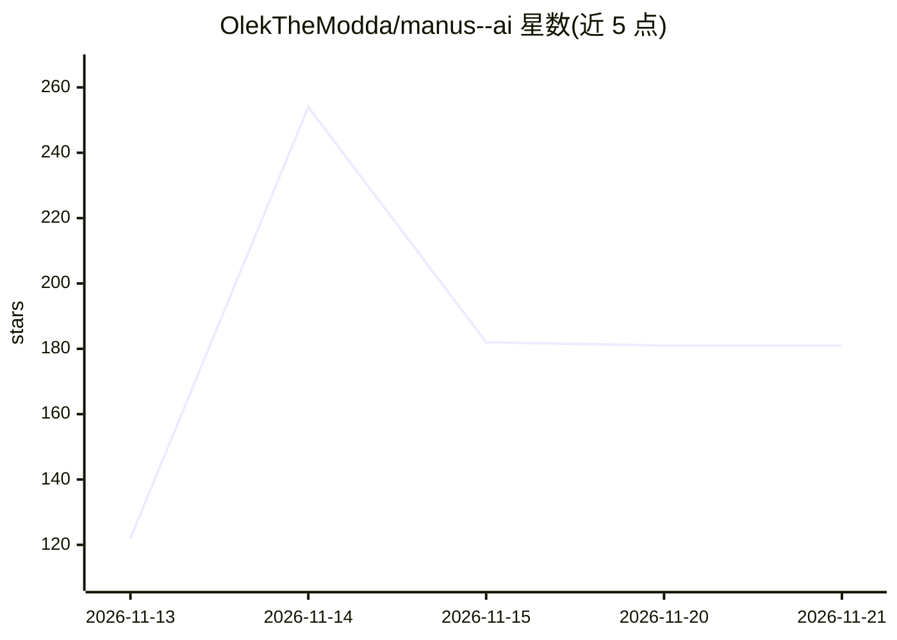

# OlekTheModda/manus--ai

⭐ 181 · Apache-2.0 · 推送 2026-11-15 · [GitHub](https://github.com/OlekTheModda/manus--ai) · 个人维护

**面向日常任务的自主 AI Agent：自动执行代码与浏览器操作**

Manus 是一个自主 AI 代理，代表用户编写并执行脚本、控制浏览器完成多步骤任务，定位为家庭、学习与轻量办公场景的后台个人助手，而非企业平台或聊天机器人。机制上结合代码自动化与浏览器操作，任务可在脚本与网页之间衔接；README 声明可跨会话记住任务模式。硬件要求为 64 位系统、双核 CPU、最低 4 GB 内存。README 未给出具体的安装命令、模型接入方式或源码构建步骤，仅提供配置与使用流程说明。

## 筛选速览

| 维度 | 判定 | 备注 |
|---|---|---|
| AI 角色 | `ai-native` | 本体是模型或模型工具 |
| 许可风险 | `permissive` | Apache-2.0 |
| 部署形态 | `None` |  |
| 模型依赖 | — | README 未给出锁定关系 |
| 硬件要求 | — | 无带数字的原话,不猜 |
| 安装摩擦 | `low` | 无编译、无系统依赖或容器化 |
| 成熟度 | — | 结构信号不足 |

## 能力要点

- 自主执行代码与控制浏览器完成多步骤任务
- 脚本与浏览器操作在同一流程中衔接
- 面向家庭、学习与轻量办公的小规模任务场景
- 最低 4 GB 内存、双核 CPU 的兼容性要求

## 适用场景

- 让代理代为查网页、填表单、收集资料
- 组织研究笔记、跑小脚本等学习与日常事务
- 无需编程即可完成重复性小任务

## 场景标签

`AI 助手` `浏览器自动化` `编码 Agent` · 领域:效率与自动化

## 证据(README 行号)

> L10: - **Autonomous Code Execution:** Manus AI agent runs code on its own to complete tasks, so you can focus on decisio
> L18: Manus is an autonomous AI agent designed to run code and control a browser on your behalf. Instead of acting like a

## 星数曲线

2026-11-13 122 → 2026-11-21 181（+59）

---
*卡片 v1 · prompt 1.4 · 生成 2026-11-17 · 置信度 mid · 依据 README sha `67c3d4d92b69` · [字段定义](../../DATASET.md)*
