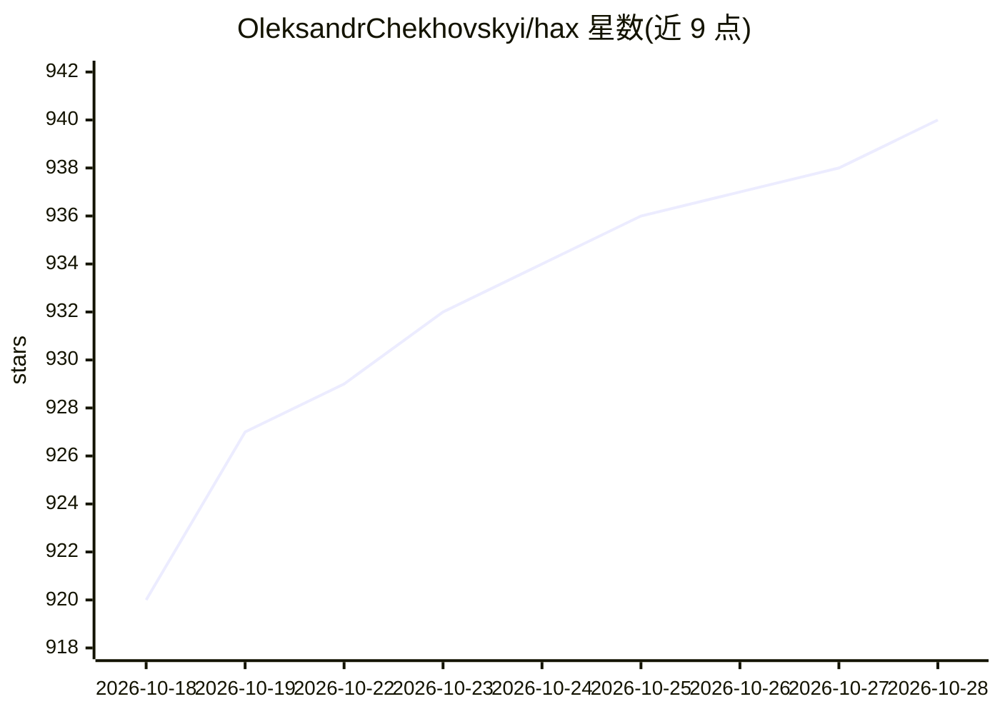

# OleksandrChekhovskyi/hax

⭐ 940 · C · MIT · 推送 2026-10-24 · [GitHub](https://github.com/OleksandrChekhovskyi/hax) · [官网](https://usehax.dev) · 个人维护

**C 编写的极简终端编码 agent，支持本地与云端模型**

单一原生 C 二进制实现的终端编码 agent：提供流式 Markdown 输出、REPL 与单次 prompt 模式、会话恢复、transcript 查看（Ctrl+T）与可选 wire 协议 trace。接入 OpenAI/Anthropic/OpenRouter/DeepSeek/llama.cpp/Ollama 等多种 provider，对本地模型（llama.cpp/Ollama）提供自动发现，无需专属配置块。通过子进程而非插件组合，配套可选 Python CLI（hax-web 网页搜索、hax-mcp MCP 工具）。安装途径含 Homebrew、AUR、预编译二进制与源码编译（依赖 libcurl、jansson 等）。Windows 仅限 WSL。

## 筛选速览

| 维度 | 判定 | 备注 |
|---|---|---|
| AI 角色 | `ai-ecosystem` | LLM/agent 周边工具 |
| 许可风险 | `permissive` | MIT |
| 部署形态 | `None` |  |
| 模型依赖 | local-ok | 支持本地模型 |
| 硬件要求 | — | 无带数字的原话,不猜 |
| 安装摩擦 | `medium` | 含编译或系统依赖之一 |
| 成熟度 | — | 结构信号不足 |

## 能力要点

- 单一 C 二进制，常驻内存仅数 MB，冷启动快
- 本地模型一等公民：llama.cpp/Ollama 自动发现模型与运行时能力
- 多 provider 接入：OpenAI(+兼容)/Anthropic(+兼容)/Codex/OpenRouter/DeepSeek/自定义端点
- 可审查性：transcript 视图与 wire 协议 trace

## 适用场景

- 在终端里用本地或云端模型做编码问答与任务执行
- 资源受限或需打包进发行版的环境运行 agent
- 审计 agent 实际发送给模型的内容

## 场景标签

`编码 Agent` · 领域:编码与开发

## 证据(README 行号)

> L12: - **Local models are first-class** — Start `llama-server -m [model].gguf`, then
> L20: - **Broad provider support** — OpenAI (+compatible), Anthropic (+compatible), Codex (via a ChatGPT

## 星数曲线

2026-10-18 920 → 2026-10-28 940（+20）

---
*卡片 v1 · prompt 1.4 · 生成 2026-10-21 · 置信度 high · 依据 README sha `58af3832def7` · [字段定义](../../DATASET.md)*
