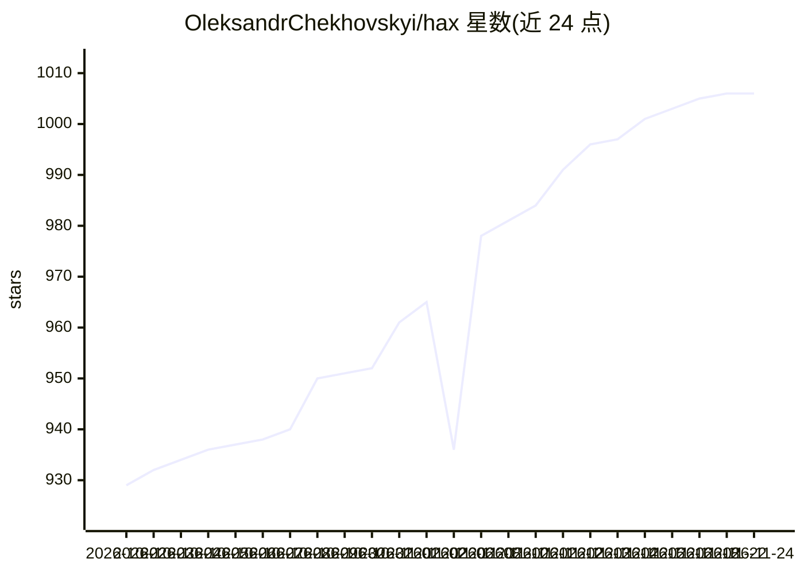

# OleksandrChekhovskyi/hax

⭐ 1,008 · C · MIT · 推送 2026-11-13 · [GitHub](https://github.com/OleksandrChekhovskyi/hax) · [官网](https://usehax.dev) · 个人维护

**给终端开发者的极简 C 语言编码 agent CLI**

用 C 编写的终端原生编码 agent，单个二进制、依赖少、内存占用仅数 MB。支持流式 Markdown 输出、工具调用可视化、会话恢复（-c/--resume）、一次性模式（-p）与 stdin 管道输入；通过 /provider 选择模型与提供商，默认无需配置即可自动发现本地 llama.cpp 模型。可扩展 hax-web（网页抓取）与 hax-mcp（MCP 工具）两个 Python 伴生 CLI。刻意不提供插件运行时、IDE 面板与逐命令权限提示。

## 筛选速览

| 维度 | 判定 | 备注 |
|---|---|---|
| AI 角色 | `ai-ecosystem` | LLM/agent 周边工具 |
| 许可风险 | `permissive` | MIT |
| 部署形态 | `None` |  |
| 模型依赖 | local-ok | 支持本地模型 |
| 硬件要求 | — | 无带数字的原话,不猜 |
| 安装摩擦 | `medium` | 含编译或系统依赖之一 |
| 成熟度 | — | 结构信号不足 |

## 能力要点

- 单一 C 二进制，即时启动、内存占用数 MB
- 本地模型一等公民：自动发现 llama-server 运行的模型
- 支持 OpenAI/Anthropic 兼容端点、OpenRouter、DeepSeek、Ollama 等多提供商
- 交互转录视图（Ctrl+T）可查看发送与回复内容

## 适用场景

- 在终端里用本地模型做代码问答与改动
- 资源受限环境中运行编码 agent
- 对发行版打包一个静态链接的编码 agent 工具

## 场景标签

`编码 Agent` · 领域:编码与开发

## 证据(README 行号)

> L3: **A minimalist, terminal-native coding agent written in C.**
> L20: - **Broad provider support** — OpenAI (+compatible), Anthropic (+compatible), Codex (via a ChatGPT
> L27: Developers who live in the terminal, run local models, audit what their tools do, package

## 星数曲线

2026-10-22 929 → 2026-11-24 1,006（+77）

---
*卡片 v1 · prompt 1.4 · 生成 2026-11-24 · 置信度 high · 依据 README sha `be13c7fb111a` · [字段定义](../../DATASET.md)*
