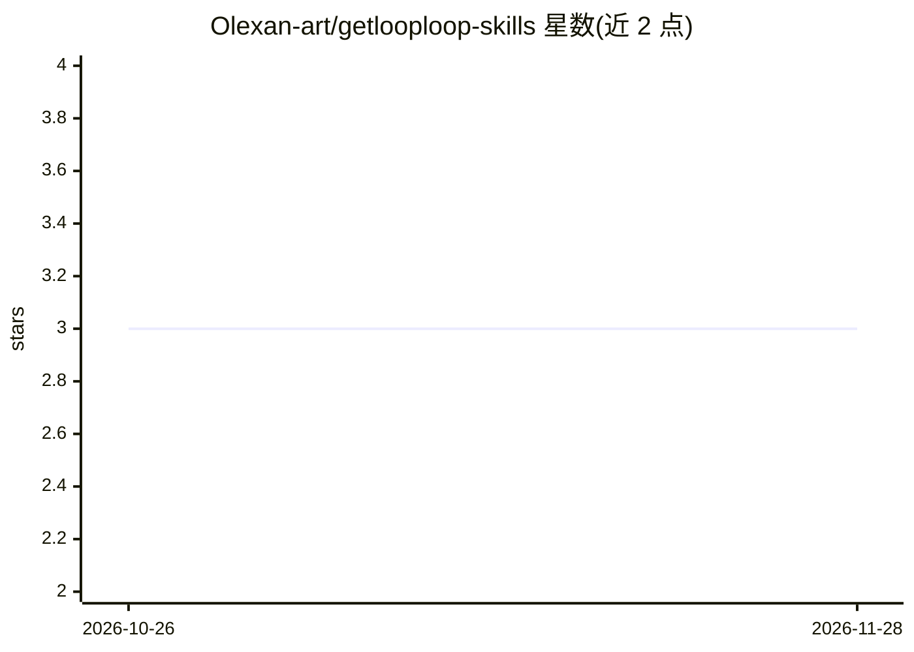

# Olexan-art/getlooploop-skills

⭐ 3 · JavaScript · MIT · 推送 2026-11-14 · [GitHub](https://github.com/Olexan-art/getlooploop-skills) · 个人维护

**面向网站主的 agent 技能：本地模拟 AI 检索器如何读取页面**

GetLoopLoop 发布的 SKILL.md 格式 agent 技能，核心为 vectorscope：对任一公开页面复现检索系统的抓取、抽取、切分与 26 段上限，检查 AI 爬虫的 robots.txt 许可、结构问题、文本模板化程度，并给出改写计划，支持 2-5 页对比，报告为自包含 HTML/Markdown/JSON，界面支持英/乌/波三语。面向 claude.ai、Claude 桌面端、Claude Code、Codex、opencode 等加载技能的 agent。脚本仅用 Node 内置与捆绑的 cheerio，无需 npm install；分组与查询判定由 agent 完成而非嵌入调用。

## 筛选速览

| 维度 | 判定 | 备注 |
|---|---|---|
| AI 角色 | `ai-native` | 本体是模型或模型工具 |
| 许可风险 | `permissive` | MIT |
| 部署形态 | `desktop` | 安装包/桌面程序 |
| 模型依赖 | — | README 未给出锁定关系 |
| 硬件要求 | — | 无带数字的原话,不猜 |
| 安装摩擦 | `low` | 无编译、无系统依赖或容器化 |
| 成熟度 | — | 结构信号不足 |

## 能力要点

- 复现产品的 fetch/抽取/切分/26 段上限流程，逐段标注 measured/derived/judgement 来源
- 检查 GPTBot、ClaudeBot、PerplexityBot 等 12 种 AI 爬虫的 robots.txt（RFC 9309 匹配）
- GetLoopLoop PatternScore 评估文本模板化程度，附 agent 逐段 swap test
- 支持 2-5 页共享主题词典对比及前后 diff

## 适用场景

- 检查我的页面能否被 AI 爬虫抓取和引用
- 找出被 26 段上限截断、检索器读不到的内容
- 比较自己与竞品页面在典型问题上的覆盖
- 按改写计划逐段优化最弱的段落

## 场景标签

 · 领域:SEO/GEO 网站分析工具

## 证据(README 行号)

> L7: Agent Skills from GetLoopLoop, for claude.ai and the Claude desktop app, Claude Code, Codex, opencode, Hermes Agent 
> L11: |`vectorscope`|Shows how a retrieval system reads public pages: the product's exact fetch, extraction, chunking and

## 星数曲线

2026-10-26 3 → 2026-11-28 3（+0）

---
*卡片 v1 · prompt 1.4 · 生成 2026-11-22 · 置信度 high · 依据 README sha `890feb9b5a12` · [字段定义](../../DATASET.md)*
