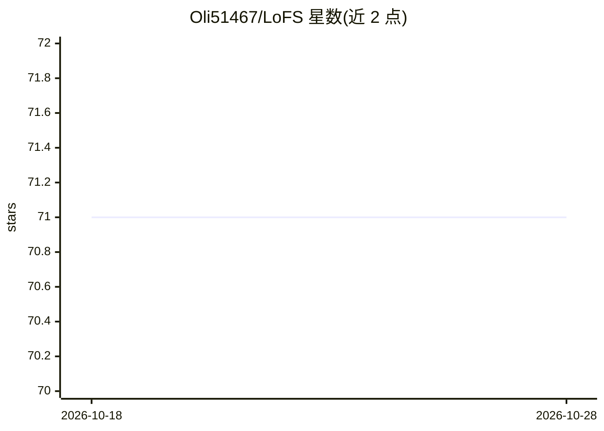

# Oli51467/LoFS

⭐ 71 · JavaScript · NOASSERTION · 推送 2025-11-05 · [GitHub](https://github.com/Oli51467/LoFS) · 个人维护 · 中文 README

**本地知识库桌面应用：文件管理+语义检索+多模型对话**

面向本地优先知识管理的 Electron 桌面应用，FastAPI 后端承载挂载、解析与索引构建。挂载目录后自动解析 md/txt/docx/pdf/pptx/json 及图片，文本向量写入 Faiss、关键词写入 BM25s、元数据存 SQLite，图片生成 CLIP 向量；检索采用主题摘要优先召回（语义×词法 0.6/0.4 融合，分数不足自动回退混合检索）。内置 SiliconFlow，兼容 ModelScope 与通义千问（DashScope），支持流式问答、<think> 思考卡片与图片上传多轮对话。从源码运行：Python 3.8+/Node.js 16+，git clone 后 npm run dev 启动，package.py 一键打包，模型经 huggingface_hub 按需下载。

## 筛选速览

| 维度 | 判定 | 备注 |
|---|---|---|
| AI 角色 | `ai-native` | 本体是模型或模型工具 |
| 许可风险 | `none` | NOASSERTION |
| 部署形态 | `None` |  |
| 模型依赖 | — | README 未给出锁定关系 |
| 硬件要求 | — | 无带数字的原话,不猜 |
| 安装摩擦 | `low` | 无编译、无系统依赖或容器化 |
| 成熟度 | — | 结构信号不足 |

## 能力要点

- 多模态解析：文本、PDF/PPTX 专属解析与 CLIP 图像向量
- 主题摘要优先的两阶段检索，含语义×词法加权与自动回退
- 接入 SiliconFlow、ModelScope、DashScope 三平台模型，含连通性检测与流式输出
- 本地 SQLite + Faiss 存储，核心数据不出域

## 适用场景

- 把本地文档目录挂载成可语义检索的知识库并直接提问
- 在聊天中上传图片结合视觉模型做图像理解
- 检索结果附带参考文档主题卡片用于定位资料

## 场景标签

`知识库管理` `语义搜索` `聊天机器人` · 领域:对话与助手

## 证据(README 行号)

> L7:  LoFS（Load once Fast Search）是一款面向本地知识库的桌面级文件管理与信息检索应用，只需挂载一次，后续即可获得毫秒级的全文与语义检索体验。
> L14: - 🤖 **多平台模型接入**：内置 SiliconFlow，并新增对 ModelScope、通义千问（DashScope）的兼容，支持在线连通性检测、流式问答与 `<think>` 思考返回。
> L15: - 💬 **智能聊天体验**：聊天页记住上次选用的模型，重启后即刻恢复；模型输出的思考内容会以灰色卡片独立展示，方便分析与引用。

## 星数曲线

2026-10-18 71 → 2026-10-28 71（+0）

---
*卡片 v1 · prompt 1.4 · 生成 2026-10-24 · 置信度 high · 依据 README sha `f479d43f9b88` · [字段定义](../../DATASET.md)*
