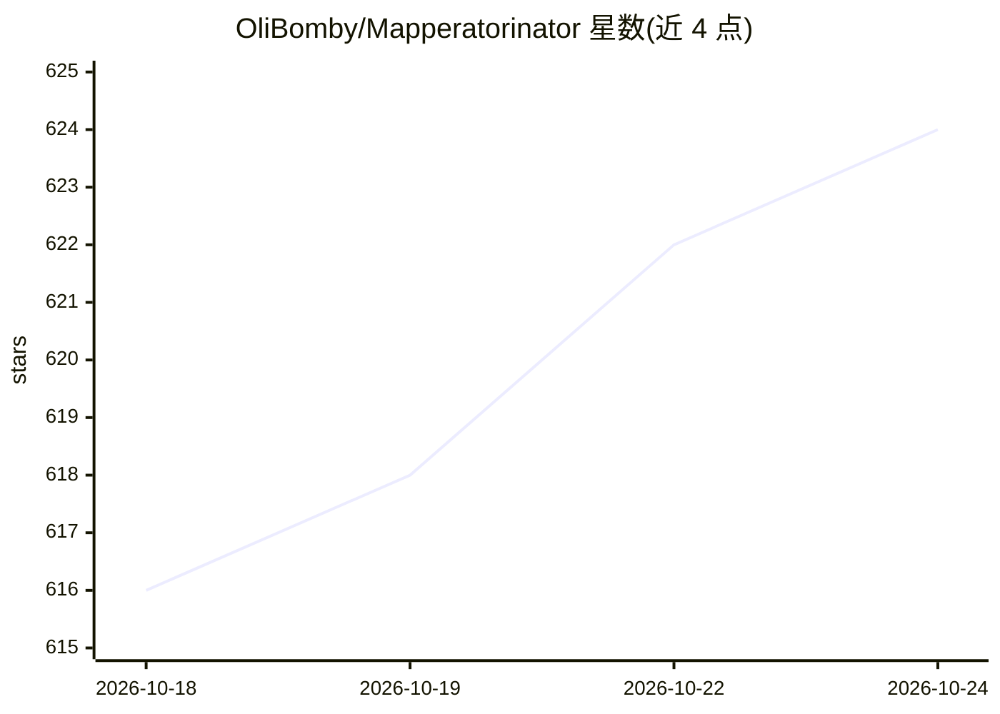

# OliBomby/Mapperatorinator

⭐ 624 · Python · MIT · 推送 2026-08-13 · [GitHub](https://github.com/OliBomby/Mapperatorinator) · 个人维护

**从歌曲频谱图自动生成 osu! 谱面并辅助检查谱面的 AI 框架**

多模型框架，以 Mel 频谱图为输入，为 osu! 所有游戏模式生成完整谱面，并支持通过 Hydra 参数定制难度、年份、mapper 风格与描述符等条件。模型基于改造的 Whisper 架构（219M 参数，RoPE + Flash Attention 变长注意力），采用 90% 重叠滑窗实现长曲无缝生成，V29 版用扩散模型细化打击物件坐标。附带 MaiMod 检查工具，利用模型预测找出谱面中对齐、时间点、连击等问题。面向 osu! 谱面创作者，提供 Web UI、命令行与交互式 CLI 三种使用方式，需 Python 3.10 与 PyTorch GPU 环境从源码运行。

## 筛选速览

| 维度 | 判定 | 备注 |
|---|---|---|
| AI 角色 | `ai-native` | 本体是模型或模型工具 |
| 许可风险 | `permissive` | MIT |
| 部署形态 | `desktop` | 安装包/桌面程序 |
| 模型依赖 | — | README 未给出锁定关系 |
| 硬件要求 | — | 无带数字的原话,不猜 |
| 安装摩擦 | `low` | 无编译、无系统依赖或容器化 |
| 成熟度 | — | 结构信号不足 |

## 能力要点

- 频谱图输入生成全模式 osu! 谱面，支持难度/年份/mapper 风格等条件定制
- MaiMod 利用模型预测检查谱面的对齐、时间点、连击等潜在问题
- 90% 重叠滑窗机制实现长曲无缝生成
- 扩散模型将量化的物件坐标细化至 2 像素精度

## 适用场景

- 为任意歌曲自动生成可定制的 osu! 谱面
- 检查已有谱面中人工难以发现的对齐与一致性问题
- 为现有谱面生成 Guest Difficulty 或音效（V31 模型）

## 场景标签

 · 领域:游戏/音乐内容生成

## 证据(README 行号)

> L30: Mapperatorinator is multi-model framework that uses spectrogram inputs to generate fully featured osu! beatmaps for
> L156: MaiMod is a modding tool for osu! beatmaps that uses Mapperatorinator predictions to find potential faults and inc

## 星数曲线

2026-10-18 616 → 2026-10-24 624（+8）

---
*卡片 v1 · prompt 1.4 · 生成 2026-10-21 · 置信度 mid · 依据 README sha `093795145194` · [字段定义](../../DATASET.md)*
