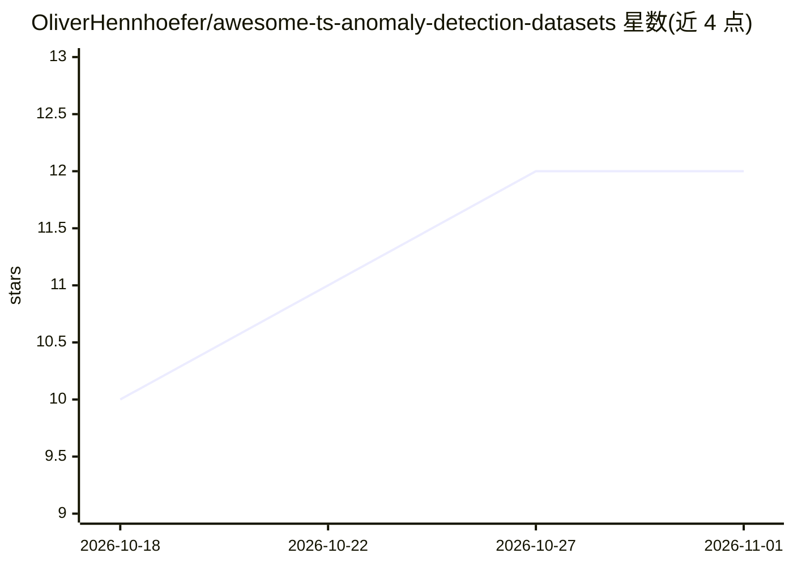

# OliverHennhoefer/awesome-ts-anomaly-detection-datasets

⭐ 12 · CC0-1.0 · 推送 2026-10-16 · [GitHub](https://github.com/OliverHennhoefer/awesome-ts-anomaly-detection-datasets) · 个人维护

**时间序列异常检测公开数据集策展清单**

由个人维护的 awesome 类清单，收录面向时间序列异常检测、事件检测与故障检测的可公开获取或研究可申请的数据集。按单变量与多变量组织，条目覆盖 Yahoo S5、NASA SMAP/MSL、ESA-ADB、SWaT/WADI、风电 SCADA、水网攻击等约 30 个来源，逐条给出获取方式（Zenodo/UCI/GitHub/申请）、领域与关联论文。清单专设基准质量章节，采用 Wu and Keogh 的四项筛查标准，对存在已知问题的数据集附 Benchmark caveat 说明限制。清单本身不提供代码或安装，仅链接外部资源。

## 筛选速览

| 维度 | 判定 | 备注 |
|---|---|---|
| AI 角色 | `ai-knowledge` | 知识聚合/清单类 |
| 许可风险 | `viral` | CC0-1.0 |
| 部署形态 | `None` |  |
| 模型依赖 | — | README 未给出锁定关系 |
| 硬件要求 | — | 无带数字的原话,不猜 |
| 安装摩擦 | `low` | 无编译、无系统依赖或容器化 |
| 成熟度 | — | 结构信号不足 |

## 能力要点

- 收录单变量与多变量两类时间序列异常检测数据集
- 每个条目标注获取方式、领域与关联论文
- 专设基准质量章节，引用 Wu and Keogh 四项筛查标准
- 对有已知缺陷的数据集附 Benchmark caveat

## 适用场景

- 为异常检测模型寻找可获取的公开数据集
- 评估常用基准数据集的标签与质量风险
- 按领域（工业控制、卫星遥测、水网、IoT）定位数据

## 场景标签

`精选清单` · 领域:学习与行业

## 证据(README 行号)

> L3: A curated list of public and research-accessible datasets for time-series anomaly detection, event detection, fault 
> L14: Dataset availability and benchmark suitability are different questions. Four useful screening criteria identified b

## 星数曲线

2026-10-18 10 → 2026-11-01 12（+2）

---
*卡片 v1 · prompt 1.4 · 生成 2026-11-01 · 置信度 high · 依据 README sha `3d84675a2da2` · [字段定义](../../DATASET.md)*
