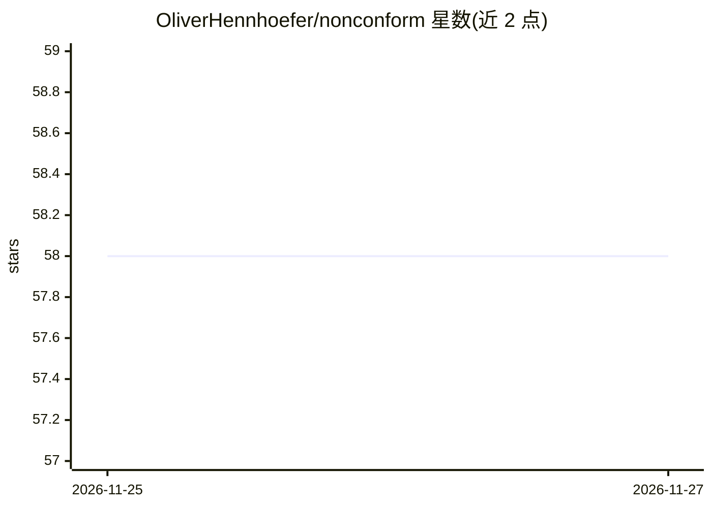

# OliverHennhoefer/nonconform

⭐ 58 · Python · BSD-3-Clause · 推送 2026-11-23 · [GitHub](https://github.com/OliverHennhoefer/nonconform) · [官网](https://oliverhennhoefer.github.io/nonconform/) · 个人维护

**为异常检测器提供统计误报率保证的 Python 校准库**

nonconform 是一个 Python 异常检测库：将现有检测器（PyOD、scikit-learn 或自定义协议实现）的异常分数在正常数据上校准，按用户设定的错误率生成阈值，支持 FDR 控制的批量筛选、带置信界定的 FPR 原始分数阈值证书，以及基于可交换性鞅的流式变点监控。提供 Split、CrossValidation、JackknifeBootstrap 等工作流与加权共形推断、Mondrian p 值等扩展。需 Python 3.11+，从 PyPI 安装，可选 extras 启用 PyOD、数据集、在线 FDR、概率估计功能。

## 筛选速览

| 维度 | 判定 | 备注 |
|---|---|---|
| AI 角色 | `ai-native` | 本体是模型或模型工具 |
| 许可风险 | `permissive` | BSD-3-Clause |
| 部署形态 | `library` | 以包/库形式分发 |
| 模型依赖 | — | README 未给出锁定关系 |
| 硬件要求 | — | 无带数字的原话,不猜 |
| 安装摩擦 | `low` | 无编译、无系统依赖或容器化 |
| 成熟度 | — | 结构信号不足 |

## 能力要点

- 包装任意 PyOD / scikit-learn / 自定义检测器并校准其分数
- 按目标 FDR 或 FPR 生成阈值，提供有限样本统计保证
- 流式监控：可交换性鞅在数据漂移时触发告警
- 提供 Claude Code / Codex 的 agent skill 安装渠道

## 适用场景

- 不想拍脑袋设 top 10% 阈值，而是按可接受误报率筛选异常
- 对生产数据流监控分布漂移并触发告警
- 在协变量偏移或分组行为不同的数据上做共形校准
- 让编码 agent 按 API 规范正确使用该库

## 场景标签

 · 领域:机器学习/统计推断工具

## 证据(README 行号)

> L7:  Turn anomaly scores into flags with a false-alarm rate you set.
> L22: anomalies there are. `nonconform` calibrates the scores of your existing detector
> L84: With 95% probability over the calibration draw, the threshold flags at most 5%

## 星数曲线

2026-11-25 58 → 2026-11-27 58（+0）

---
*卡片 v1 · prompt 1.4 · 生成 2026-11-24 · 置信度 high · 依据 README sha `dbd43ae0c568` · [字段定义](../../DATASET.md)*
