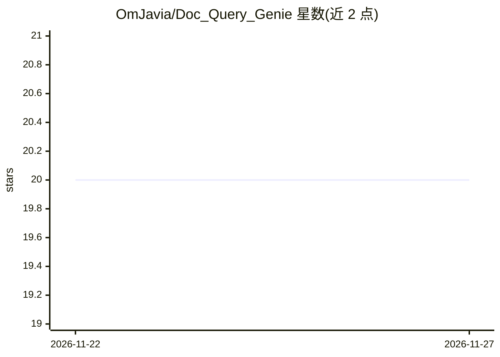

# OmJavia/Doc_Query_Genie

⭐ 20 · Python · 推送 2026-11-21 · [GitHub](https://github.com/OmJavia/Doc_Query_Genie) · 个人维护

**本地 RAG 问答服务：对自有 PDF 提问并返回带引用的答案**

基于 Flask 的本地 PDF 问答服务：上传 PDF 后由嵌入模型建 ChromaDB 向量索引，检索相关段落交给 Ollama 运行的本地 LLM 生成答案，引用按 [1][2] 标注并附文件名与页码。支持单文档或全库检索、多轮追问、token 级流式输出（NDJSON）、重复上传去重及不涉及文档的通用聊天。全部在本机运行，无需 API key；提供 Web UI 与 JSON API。无强 GPU 时生成可能需一分钟以上。

## 筛选速览

| 维度 | 判定 | 备注 |
|---|---|---|
| AI 角色 | `ai-native` | 本体是模型或模型工具 |
| 许可风险 | `none` | — |
| 部署形态 | `self-host` | docker 或自建部署 |
| 模型依赖 | local-ok | 支持本地模型 |
| 硬件要求 | — | 无带数字的原话,不猜 |
| 安装摩擦 | `low` | 无编译、无系统依赖或容器化 |
| 成熟度 | — | 结构信号不足 |

## 能力要点

- 答案按编号引用段落，来源含文件名、页码与原文
- 本地运行：无需 API key，文档不出本机
- 流式 NDJSON 输出与多轮对话历史支持
- 环境变量可配模型、上下文窗口、分块与 TOP_K 等参数

## 适用场景

- 在本机对个人 PDF 文档提问并查看页码级出处
- 处理含隐私内容的文档，避免数据外发
- 通过 JSON API 把文档问答接入自己的应用

## 场景标签

`文档问答` · 领域:知识与检索

## 证据(README 行号)

> L3: 🚀 **Ask questions about your PDFs with a local LLM.** Retrieval-Augmented Generation (RAG) with Llama 3, LangChain, 
> L9: Upload a PDF, then ask questions about it. Doc_Query_Genie finds the most relevant passages and has a local LLM answ

## 星数曲线

2026-11-22 20 → 2026-11-27 20（+0）

---
*卡片 v1 · prompt 1.4 · 生成 2026-11-22 · 置信度 high · 依据 README sha `aadf5c978513` · [字段定义](../../DATASET.md)*
