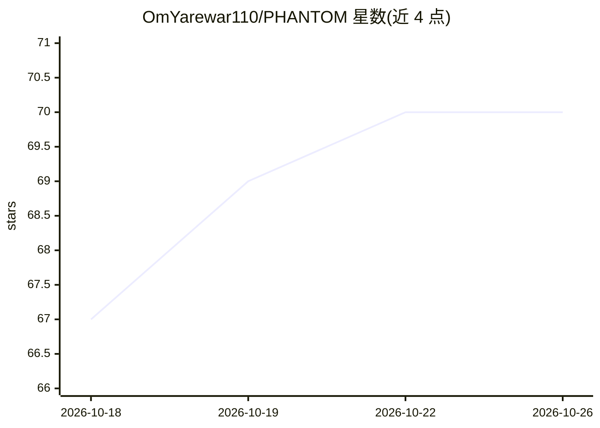

# OmYarewar110/PHANTOM

⭐ 70 · JavaScript · MIT · 推送 2026-10-20 · [GitHub](https://github.com/OmYarewar110/PHANTOM) · [官网](https://phantom-pentest.vercel.app/) · 个人维护

**面向授权安全测试的 AI 工作台，浏览器内对话+工具流式执行**

自托管的 AI 安全调查工作台：Node.js 后端加浏览器前端，将对话、实时工具输出、本地文件、SQLite 持久化记忆与逆向工程工具发现聚合在一个界面。用户配置任意 OpenAI 兼容端点（含 Ollama/LM Studio 本地服务），agent 可读写文件、执行命令与 Python、搜索网页，工具循环次数可配置，最多 4 个并发会话。内置 REA 逆向工具桥接（rea-agents@6.7.0），执行需显式开启。提供 Docker 与本地开发两种部署方式；明确声明仅限授权用途，本地工作区非安全沙箱。

## 筛选速览

| 维度 | 判定 | 备注 |
|---|---|---|
| AI 角色 | `ai-native` | 本体是模型或模型工具 |
| 许可风险 | `permissive` | MIT |
| 部署形态 | `self-host` | docker 或自建部署 |
| 模型依赖 | local-ok | 支持本地模型 |
| 硬件要求 | — | 无带数字的原话,不猜 |
| 安装摩擦 | `low` | 无编译、无系统依赖或容器化 |
| 成熟度 | — | 结构信号不足 |

## 能力要点

- 配置任意 OpenAI 兼容端点，包括 Ollama/LM Studio 本地服务
- 工具循环流式输出，迭代上限可配置，达到上限后做无工具综合
- 会话、发现与执行轨迹存入 SQLite，可搜索回溯
- 内置 REA 逆向工程工具目录桥接，执行需显式 opt-in

## 适用场景

- 对自有工件或日志做 AI 辅助的安全调查并生成报告
- 在浏览器中持续管理多会话安全调查与历史发现
- 通过本地模型端点离线运行安全工作台

## 场景标签

`网络安全` · 领域:学习与行业

## 证据(README 行号)

> L5: An AI security workbench that brings conversations, live tool output, local files,
> L28: - **Use your model endpoint.** Configure an OpenAI-compatible API, including
> L39: |Investigate an artifact|Read files, run commands, execute Python, and save a report in your workspace|

## 星数曲线

2026-10-18 67 → 2026-10-26 70（+3）

---
*卡片 v1 · prompt 1.4 · 生成 2026-10-24 · 置信度 mid · 依据 README sha `394237e20349` · [字段定义](../../DATASET.md)*
