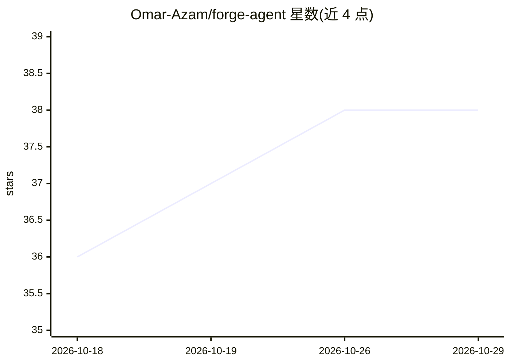

# Omar-Azam/forge-agent

⭐ 38 · JavaScript · MIT · 推送 2026-07-23 · [GitHub](https://github.com/Omar-Azam/forge-agent) · 个人维护

**免费自主编程 agent：浏览器驱动网页版 AI 写代码**

面向开发者的 CLI 编程 agent，通过 Playwright 浏览器自动化驱动 DeepSeek、ChatGPT 或 Gemini 的免费网页界面，使其无需 API key 即可自主完成读文件、写代码、跑测试、执行终端命令等任务并循环至完成。内置 37+ 工具、agent 画像（backend/frontend/data-science/devops）、10 个任务模板、会话恢复、插件机制与安全沙箱（拦截 SSH 密钥、凭据、路径穿越）。提供 npm 全局安装与官方 Docker 镜像，跨 Linux/macOS/Windows。

## 筛选速览

| 维度 | 判定 | 备注 |
|---|---|---|
| AI 角色 | `ai-ecosystem` | LLM/agent 周边工具 |
| 许可风险 | `permissive` | MIT |
| 部署形态 | `self-host` | docker 或自建部署 |
| 模型依赖 | — | README 未给出锁定关系 |
| 硬件要求 | — | 无带数字的原话,不猜 |
| 安装摩擦 | `low` | 无编译、无系统依赖或容器化 |
| 成熟度 | — | 结构信号不足 |

## 能力要点

- 浏览器自动化驱动 DeepSeek/ChatGPT/Gemini 网页版，无需 API key
- 37+ 内置工具覆盖文件、shell、git、测试、环境变量
- 5 种 agent 画像与 10 个任务模板
- 安全沙箱拦截 SSH 密钥、凭据与路径穿越

## 适用场景

- 不付费 API 让 AI 自主完成编码任务
- 按角色画像（后端/前端/数据科学/DevOps）执行项目任务
- 中途中断后恢复会话继续任务

## 场景标签

`编码 Agent` `浏览器自动化` · 领域:效率与自动化

## 证据(README 行号)

> L3: **Autonomous AI Coding Agent — No API Key Needed**
> L5: Forge Agent drives DeepSeek, ChatGPT, or Gemini through browser
> L23: - **Autonomous** — Reads files, writes code, runs tests. Loops until done.

## 星数曲线

2026-10-18 36 → 2026-10-29 38（+2）

---
*卡片 v1 · prompt 1.4 · 生成 2026-10-25 · 置信度 high · 依据 README sha `1448508499db` · [字段定义](../../DATASET.md)*
